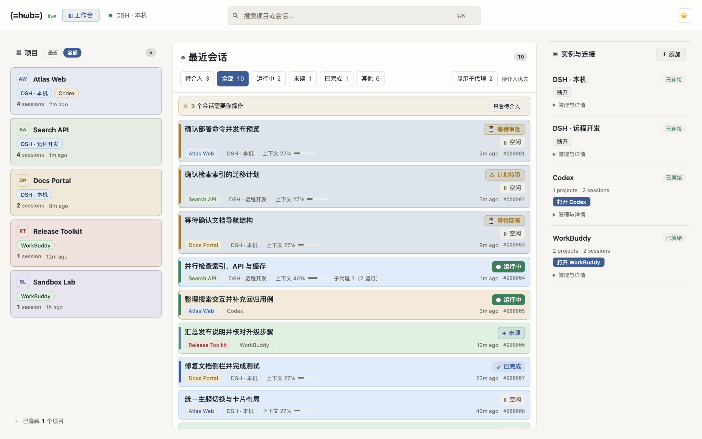
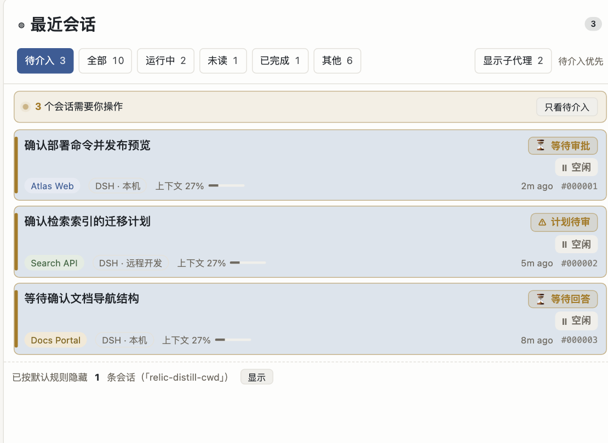
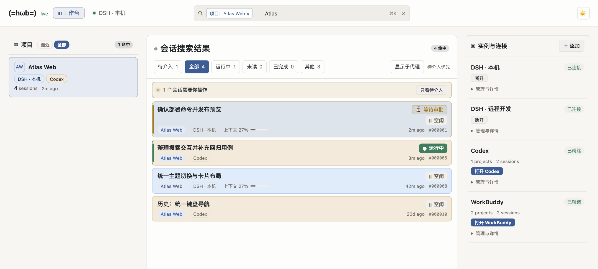
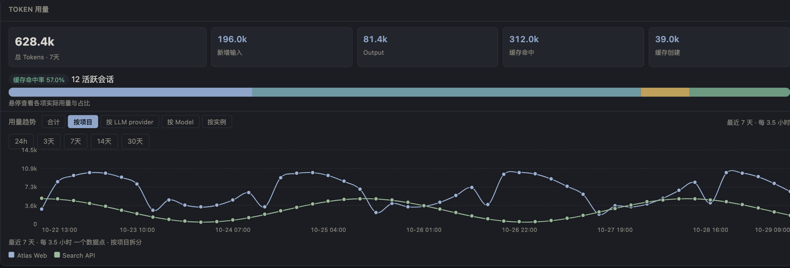

# hwb — harness workbench

[](https://github.com/biociao/hwb/actions/workflows/ci.yml)
[](CHANGELOG.md)
[](DSH_Workbench_Fusion_Architecture.md)
[](package.json)
[](package.json)
[](LICENSE)

`hwb`（harness workbench）是一个面向 harness工具（目前主要支持的是DeepSeek Harness，即dsh）的**本地工作台**，用于应付需要开启多个dsh实例的情况——当前dsh在项目和任务数增多后会变得难以管理和跟踪。
`hwb`会构建一份本地 SQLite 索引，在一个纯元数据仪表盘里跨实例展示**最近项目 / 会话 / 实例状态 / Token 用量**，并通过一个**控制平面**去启动、停止、重启 dsh web 进程（本机），或经 SSH 隧道接入**远端** dsh 实例。

它**只读** dsh 的元数据文件，保持dsh独立运行，也**不会读取** `.zstd` 会话正文。
（唯一例外：可选的「在 DSH 桌面端打开会话」插件开启后，hwb 会写 **一个** 控制触发器
`<home>/hwb/open-session.json` 来传递「打开哪个会话」，见
[在 DSH 桌面端打开会话](#在-dsh-桌面端打开会话可选插件)。）
它也不会替代 dsh web——只一站式托管它、快速找到它、直达会话，让你在一处总揽所有实例的工作状态。

> 设计文档（三平面架构、数据模型、控制状态机、里程碑）见
> [`DSH_Workbench_Fusion_Architecture.md`](DSH_Workbench_Fusion_Architecture.md)；
> 拓扑可视化附录见 [`docs/topology.md`](docs/topology.md)。
> 变更记录见 [`CHANGELOG.md`](CHANGELOG.md)。

## 界面预览

以下截图由 **v0.2.0 的真实前端**渲染，使用合成演示数据；项目、会话、实例和用量均为示例。

**多工具会话总览** — 在一处查看 dsh、Codex、WorkBuddy 的项目与会话，区分待介入、运行中、未读和已完成状态；运行中的父会话显示子代理负载。



<details>
<summary>展开功能截图：待介入提醒、项目搜索与 Token 用量</summary>

**待介入提醒** — 一键筛出等待审批、计划待审和等待回答的会话，优先处理需要你操作的任务。



**项目筛选与搜索** — 从项目卡进入会话列表，再将搜索范围限定到当前项目，快速定位相关记录。



**Token 用量与深色主题** — 切换统计周期与分组维度，查看输入、输出、缓存构成及按项目拆分的趋势。



</details>

截图可通过 [`scripts/readme-screenshots.mjs`](scripts/readme-screenshots.mjs) 重新生成：
`node scripts/readme-screenshots.mjs`（需要 Chrome；Linux 可用 `CHROME_PATH` 指定可执行文件）。

---

## 目录

- [界面预览](#界面预览)
- [它做什么 / 不做什么](#它做什么--不做什么)
- [核心能力](#核心能力)
- [环境要求](#环境要求)
- [快速开始](#快速开始)
- [工作台怎么用](#工作台怎么用)
- [读取的 dsh home 文件](#读取的-dsh-home-文件)
- [Codex 作为实例接入（可选数据源）](#codex-作为实例接入可选数据源)
- [WorkBuddy 作为只读本地实例](#workbuddy-作为只读本地实例)
- [本地 dsh 只读实例（Codex 式）](#本地-dsh-只读实例codex-式)
- [在 DSH 桌面端打开会话（可选插件）](#在-dsh-桌面端打开会话可选插件)
- [架构：三平面分离](#架构三平面分离)
- [REST API](#rest-api)
- [辅助工具包](#辅助工具包)
- [项目结构](#项目结构)
- [测试](#测试)
- [dsh 版本兼容性](#dsh-版本兼容性)
- [已知限制](#已知限制)
- [安全边界](#安全边界)
- [路线图](#路线图)
- [许可](#许可)

---

## 它做什么 / 不做什么

**做：**

- 读取多个 dsh home，聚合出**跨实例**的统一视图：最近项目、最近会话、各实例状态与额度。
- 为每个实例展示 **Token 用量**：总量、输入/输出、缓存命中/创建、缓存命中率，以及
  按 **维度**（合计 / 项目 / LLM provider / 按 Model / 实例）**堆叠**的分时趋势柱状图。
- **托管** dsh web：本机直接拉起子进程，远端经 `ssh -L` 按需隧道接入。
- 每个实例给浏览器一个**直接可寻址**的入口：**本地** home 用原始服务连接
  `http://127.0.0.1:<port>/?token=<x>`（同机直连，无需转发）；**远程** home 经 hwb 的
  **1:1 根路径反向代理** 提供（`/plugins/*`、`/assets/*`、WebSocket 全部走通，不暴露隧道端口）。
- **主题一致性**：切换 hwb 的界面外观时，把同一个偏好单向下发给各已连接的 dsh 实例
  （写它们的 `settings.yaml` + 让已打开的页面即时换肤），并带一个可关闭的开关。

**不做（显式非目标，见架构文档 §12）：**

- 不重新实现 dsh web 本身，只托管与展示它。
- 不读取 `.zstd` 会话正文做仪表盘（只在钻入时交给 dsh web 自己处理）。
- 不充当 LLM 网关 / 代理请求——余额查询是只读的，key 永不出服务端。
- 不复制 dsh 的项目结构语义——Reader 适配它，不定义它。

---

## 核心能力

| 能力 | 说明 |
|------|------|
| **多实例聚合** | 一张工作台看全本机 + 所有 SSH 远程 dsh 实例的项目 / 会话 / 用量 |
| **项目范围（全部 / 最近）** | 项目栏默认显示**全部项目**（不设时间窗，上限 1000 条，含无会话的工作区），分区头一键切到「最近」（近 7 天有活动，上限 200 条）；偏好持久化。被上限截断时列表底部明确写「仅显示前 N 个」，不把被截断的数字当成项目总数（老版本固定 `LIMIT 20` 且无任何提示） |
| **顶栏搜索** | 顶部中间的全局搜索，输入即过滤项目 / 会话，停手 200ms 补搜**全库历史**；下拉按项目 / 会话分组，保留会话状态。可显式限定当前项目并移除范围标签；`⌘K` / `Ctrl+K` / `/` 聚焦、方向键选择、`Esc` 或 ✕ 清空 |
| **点项目筛会话** | 点 Recent Projects 的任意项目卡，Recent Sessions 只列**该项目名下的全部会话**（跨实例、按最后活动倒序，不受「最近 50 条」限制）；再点同一个项目或筛选条的 ✕ 取消。筛选条保留「打开项目」按钮，等价于原来的「点项目卡跳实例 / 桌面端」 |
| **人工介入提示** | 会话卡直接标出**在等你操作**的会话：`等待审批`（dsh 弹出 Approve / 拒绝）、`计划待审`、`等待回答`。审批/计划审阅来自 dsh 的 **remote-events 实时通道**（`approval/request` / `user-questions/request`），等待回答另有**持久投影**兜底（`userQuestions.questions.active`，离线/远端实例也可见）。介入会话固定排最前、有「待介入」筛选与列表顶部提示条，SSE `intervention:updated` 实时刷新 —— 不再因为「看上去空闲」而漏掉卡住的任务 |
| **隐藏项目** | 批量/自动化项目（默认 `relic-distill-cwd`）的项目卡**从项目列表移入栏底「已隐藏 N 个项目」折叠栏（默认收起，主动展开才可见）**，会话默认不显示在 Recent Sessions（底部「已按默认规则隐藏 N 条 · 显示」可临时展开）；显式点开该项目仍看全部，筛选条里「隐藏 / 取消隐藏」可调整并持久化到 localStorage |
| **当前项目 / 当前会话** | 每个实例（本地 + 远程）缓存「最近活跃会话 + 其所属项目」的元数据与状态（标题 / 状态 chip / token / 上下文 / 最近活动），并在 Recent Projects / Recent Sessions 中跨实例聚合展示 |
| **零 I/O 读取层** | 只读投影缓存 `session_projcache.json`（`projection cache` 层），**不下探 `.zstd`** |
| **远程只读索引** | 经一次 `ssh host bash -s` 在远端 cat 出 dsh home 的 4 个元数据文件，与本地共用同一套 schema 验证 / 域降级——远程实例的当前项目/会话与本地同构 |
| **版本降级** | 每个文件按 `unit.version` 校验；主版本不兼容时该域标 `degraded`，其余照常，不白屏 |
| **进程管理** | 30s 心跳探测 + 状态机（stopped/running/degraded/gone）+ 退避重连 + 进程指纹防误杀；**稳定第一**——连接问题只降级重探测，不重启/杀实例，启停需确认 |
| **按需隧道** | 远端点「打开」才建 `ssh -L`，关闭后不复用长期隧道，省端口与连接 |
| **手填 token 直连** | 实例设置/添加表单 `token` 栏——远端自行更新 dsh 后填入新 token 即直连，**不重启实例**；不可达时自带可自行执行的 ssh 命令提示 |
| **Token 用量面板** | 汇总 + 分时堆叠趋势（自适应桶粒度）+ 按项目拆分 |
| **会话深链** | 客户端装有 `dsh-session-deeplink` 插件时，可二段跳转直达单个会话，且有加载遮罩防白闪 |
| **Codex 实例（只读）** | 在 INSTANCES 里添加 Codex（`harness=codex`），只读 `state_5.sqlite` + `.codex-global-state.json`；其项目/会话进入 RECENT PROJECTS/SESSIONS，点击经 `codex://` 深链跳回 Codex |
| **WorkBuddy 实例（只读）** | 在 INSTANCES 里添加 WorkBuddy（`harness=workbuddy`），只读 `workbuddy.db` 的项目/会话元数据；点击经 `workbuddy://chat/<id>` 跳回 WorkBuddy |
| **本地工具统一口径** | Codex / WorkBuddy / 本地 dsh 只读共用一张卡（`<label> <version>` 身份 chip、已就绪/路径缺失、`索引 lastIndexedAt`、打开/重新索引/设置）与一个打开入口 `POST /api/harness/open` |
| **SSH 远程生命周期** | 远端点按钮即可启动 / 重启 / 关闭远端 dsh web（把 `dsh-remote-web.sh` 算法搬进 Node） |
| **主题同步** | hwb 切主题单向下发给已连接的 dsh 实例：写其 `settings.yaml`（持久）+ 注入脚本即时换肤；逐实例报成功/失败，可在主题菜单里关闭 |

---

## 环境要求

- **Node.js ≥ 22**（需要 `node:sqlite`，Node 22.5+；建议 22.x 或更新，实测 v22.21.1）。
- 本机需可用 `dsh` 命令（起本地 dsh web 时；用**裸 `dsh web --port <n> [--no-open]`**，新旧版 dsh 均兼容）。
- 远端实例需可通过 SSH 别名/密钥连接（`~/.ssh/config` 的 `Host` 或 `user@host`）。

---

## 快速开始

克隆后（项目无需构建，无 bundler）：

```bash
# 安装依赖：无（零 npm 依赖）。直接用 Node 运行即可。
node src/server.js
# 默认监听 http://127.0.0.1:4310
```

> **不需要 `--home`**：实例（本机 dsh home / SSH 远程）统一在**工作台 UI** 里添加、管理
> （见下文「添加实例」），首次启动的 onboarding 会自动检测 `~/.dsh` 并提示添加。
> `--home` 只是**可选**的启动时预注册捷径，不传完全正常。

### 统一管理命令

在仓库目录执行一次 `npm link`，即可在任意目录使用 `hwb`（Node.js 22.5+，macOS / Linux）。

> **如果 `hwb` 报 `zsh: permission denied: hwb`（而 `which hwb` 找得到它）**：
> 全局 bin 是个软链（`~/.nvm/.../bin/hwb -> …/hwb/src/cli.js`），症状说明**目标文件**丢了可执行位。
> `chmod +x src/cli.js` 即可恢复；仓库现在把 `src/cli.js` 记为 **100755**，所以正常 clone 不会再遇到。
> 之所以要写在这里：这种丢失 `git status` **不会提示**（索引原本就是 0644），只能靠症状认出来。

```bash
hwb start                  # 后台启动，等待 HTTP 监听成功
hwb status                 # 状态、PID、启动时间、实际监听端口
hwb stop                   # 优雅停止
hwb restart                # 重启并应用新配置
hwb logs -n 100             # 最近 100 行日志
hwb logs -f                # 持续跟随日志（支持轮转）
hwb config show            # 查看完整配置
hwb config set port 4320
hwb config set verbose true
hwb config set homes '["~/.dsh"]'
hwb config update ./hwb.json # 合并 JSON 文件；校验成功后原子保存
hwb restart                # 更新配置后执行
hwb doctor                 # Node、配置、运行服务 HTTP 检查 + dsh 版本兼容性自检
hwb test                   # 全部测试
hwb test --test-name-pattern=CLI
hwb upgrade                # Git 快进更新 → 测试 → 原在运行则重启
hwb --help
```

`hwb` / `hwb serve` 保留前台运行方式，并读取同一份配置；原有 `--port` 等选项可覆盖配置。
`node src/server.js` 和 `npm start` 仍是原来的直接启动方式，不读取新配置文件，也不受后台管理命令控制。

配置保存在 `~/.hwb/config.json`，支持 `port`、`db`、`intervalMs`、`homes`、`log`、`verbose`、`silent`、`theme`；
`log: false` 禁用结构化文件日志。`theme`（`light` / `dark` / `system`）是界面外观偏好，也是**下发给 dsh 实例**的那个值。
`hwb config path` 显示配置位置。相对路径在保存时转为绝对路径。
设置 `HWB_DIR=/其他目录 hwb ...` 可隔离一套服务的配置、数据库和运行文件（多服务需配置不同端口）。
实例及连接端点继续通过工作台管理，保存在数据库中。

后台服务不依赖终端，但不提供开机自启或崩溃自动拉起。它通过权限为 `0600` 的本地套接字管理自身，
不会按端口或 PID 文件杀进程。启动失败会把原因（以及完整日志的位置）直接打在终端上，
完整的 `~/.hwb/service.log` 仍然是权威记录。

`status` 的退出码可以直接用于脚本：服务在运行 → 0，未运行 → 1。
前台运行的 `hwb serve` **不创建控制套接字**，所以 `status`/`doctor` 会额外探测配置端口，
并且**确认对面确实是 hwb**（只有 hwb 才会以 `{"homes":[...]}` 回应 `/api/homes`）：
真的在服务就报 `running`（并注明是前台运行），端口被**别的程序**占用则如实说明，不会说成「已停止」，
也不会把别人的服务认成 hwb。

启停命令通过锁文件串行执行：锁里记着持有者 PID 并且持有者持续心跳，
被 `kill -9`（甚至 PID 之后被系统回收）留下的残留锁会被自动接管并提示；只有在锁**确实被活着**的
启停命令持有时才会拒绝，此时按提示确认后可删除 `~/.hwb/service.lock`。
停止、重启会关闭 hwb 托管的 dsh 子进程，应在相关会话空闲时操作。

`upgrade` 仅用于 Git 安装：要求工作区干净且当前分支有 upstream，只执行 `git pull --ff-only`。
测试失败时不会重启服务，也不会自动回滚已更新的源码；修复后重新测试并重启。
npm 安装可使用 `npm install -g hwb@latest` 后执行 `hwb restart`。

命令用 npm 脚本：

```bash
npm start          # node src/server.js
npm test           # 全量（含 tests/compat 版本兼容性契约）
```

命令行选项：

| 选项 | 默认 | 说明 |
|------|------|------|
| `--home <path>` | — | **可选**：启动时预注册一个 dsh home（可重复传，注册多个实例）。缺省不传，靠 onboarding 自动检测 `~/.dsh` 或经 UI 添加 |
| `--port <n>` | `4310` | hwb 监听端口（仅绑定 `127.0.0.1`） |
| `--db <path>` | `~/.hwb/hwb.db` | SQLite 索引库；传 `:memory:` 用内存库 |
| `--interval-ms <n>` | `60000` | 数据索引循环基线周期（毫秒） |
| `-v` / `--verbose` | `info` | 输出调试级日志（含每个实例状态迁移、子进程生命周期等细节） |
| `--silent` | 关 | 完全不输出到终端，仅写日志文件（适合作为服务跑） |
| `--log <file>` | `~/.hwb/hwb.log` | 日志文件路径；出错时排查用 |
| `--no-log` | — | 不落盘，只输出到终端 |

> **日志与排查**：所有输出走同一套结构化日志（`src/lib/logger.js`），分级（debug/info/warn/error/fatal）、
> 带时间戳与作用域（如 `[launcher]`、`[monitor]`），出错时把**上下文字段**（homeId / host / 端口 /
> 子进程 stderr 尾部 / 退出码）一并带上。日志文件默认 `~/.hwb/hwb.log`，超过 1MiB 自动轮转保留
> `.1/.2` 两代（同样是 0600）；`service.log`（子进程 stdout/stderr 的重定向目标，只增不减）
> 在每次 `hwb start` 之前做一次性上限控制：超过 8MiB 就轮转成 `.1`（**不是**运行中实时轮转 ——
> fd 已经交给子进程，父进程退出后不再持有）。
> **同一实例的同一失败原因不会刷屏**：首次记全（含 Error 完整堆栈），之后 10 分钟内静默、
> 窗口过后记一条摘要行；原因变化或成功一次即复位。这条是为「一个长期不可达的远端每轮索引都重记
> 同一件事」准备的 —— 实测那会让日志里 16,000 行里有 7,000 行是同一句话 + 一整套 async 栈帧。
> 当 dsh web 启动失败、SSH 隧道断连、远端 home 不可达时，查看该文件即可定位根因。

打开 `http://127.0.0.1:4310`，首次会看到一个 **onboarding 引导**：自动检测 `~/.dsh` 或手动添加。

---

## 工作台怎么用

顶部是一个 **tab 栏**：`◧ 工作台` + 每个实例一个可拖拽排序的 tab。视图切换只 show/hide，
**不重建热 iframe**（切回是瞬时的）—— 但「热」有上限：见下面的 **iframe 预算**。

**顶栏中间是全局搜索框**，与主会话区对齐，上限 520px；窄屏独占一行。输入即过滤项目 / 会话 —— 项目名、会话标题
（标题缺失时用工作区名）、会话所属项目名都参与匹配（大小写不敏感，全角/半角等价；会话 id
不参与，避免 UUID 公共前缀把「搜几个字母」变成全命中）。本地过滤是即时的（复用最近一轮数据，
SSE 刷新后继续生效）；停手 200ms 后还会请求 `GET /api/search` 在**整个索引**上补搜一次，所以
一个月前、早已不在 Recent 面板里的项目/会话也能被找到 —— 这些行带「历史」chip 标明来源
（Recent Projects 默认列出**全部**项目，可切「最近 7 天」；Recent Sessions 只含最近 50 条）。
计数显示命中数；超过返回上限（项目 20 / 会话 50）时列表底部会说明。Token 用量 / Instances / 运行日志不受影响，
搜索框下方分组展示项目与会话结果，会话保留状态标签；方向键可进入结果，Enter 打开。
没有命中时给出「清除搜索」的出路。`⌘K` / `Ctrl+K` / `/` 聚焦搜索框，`Esc` 清空（已空再按一次失焦），✕ 或空态里的
「清除搜索」同效；切到实例 tab 时搜索框隐藏（它只作用于工作台）。

**点 Recent Projects 的一行**不再直接跳到对应 app，而是把 **Recent Sessions 筛成这个项目的会话**：
服务端按项目名精确取数（`GET /api/sessions/recent?project=…`，跨实例、按最后活动倒序，最多 200 条，
不受「最近 50 条」限制），筛选条写明当前项目与条数、提供 ✕ 清除；项目卡变选中态，再点同一个项目
也会取消。原「点项目卡打开实例 / DSH 桌面端」的能力保留在筛选条的「打开项目」按钮上（会话行
点击语义不变，仍会钻入该会话）。顶栏搜索默认仍搜索全局；在下拉里点“仅搜索当前项目”才收窄范围，
框内显示可移除的项目范围标签。清空搜索后回到原来的项目浏览视图。

**隐藏项目**：批量/自动化项目（内置默认 `relic-distill-cwd`，它会在 Recent Sessions 里持续
产出成百上千条同名 "Distill durable knowledge from the" 会话）默认从工作台上移走：项目卡不再
留在项目列表，而是收进项目栏底部的 **「已隐藏 N 个项目」折叠栏**（**默认收起** —— 收起时隐藏
项目的卡与名字都不渲染，只有主动展开才可见；这正是「隐藏」区别于「原地加个已隐藏标记」的地方）。
这些项目的会话同时默认不显示，列表底部写明「已按默认规则隐藏 N 条」并给「显示」按钮。项目卡上
有直接开关：未隐藏时 hover 出现「隐藏」，隐藏后从折叠栏里点「取消隐藏」恢复。点开被隐藏的项目
仍能看到它的全部会话（显式选择覆盖默认隐藏，项目卡会自动展开在折叠栏里），此时筛选条显示
「已默认隐藏 · 取消默认隐藏」；在该筛选视图里点「默认隐藏」会自动退回默认视图，不会出现「点了
没反应」。偏好存在 localStorage（`hwb:muted-projects`）：首次打开用内置默认，用户关掉后底部会
出现「默认静音已关闭 · 恢复默认静音」把默认装回来；「显示已隐藏会话」与折叠栏展开都只是当前
视图的临时开关，不写偏好，刷新后折叠栏回到收起。隐藏只发生在展示层——接口数据、项目卡上的
会话数、搜索命中的原始行都不变，随时能看回来。

**工作台（仪表盘，纯元数据、零 iframe）** 分五块：

1. **Recent Projects（项目）** —— 跨实例聚合；点击**筛选**该项目的会话（见上，不再直接跳转实例；
   跳转走筛选条的「打开项目」）。被隐藏的项目不在主列表里，而是收进栏底的「已隐藏 N 个项目」
   折叠栏（默认收起，展开后卡片可「取消隐藏」）。卡片底色与徽标区分项目，完整来源集合通过
   独立的 app 标签展示；选中项目使用描边高亮，项目导航不展示 token 用量。三栏按约 23 / 55 / 22 分配宽度。
   分区头有 **「最近 / 全部」范围切换**：默认「全部」= 索引里的**全部项目**（不设时间窗，上限
   1000 条，含尚无会话的工作区），「最近」= 近 7 天有活动的项目（上限 200 条）；偏好存
   localStorage（`hwb:projects-scope`）。列表被上限截断时底部会写明「仅显示前 N 个」并给「查看
   全部项目」入口 —— 分区头的数字不会被误读成「项目总数」。
2. **最近会话** —— 主要内容区，待介入、运行中、未读依次优先，其余按最近活动排序；
   状态标签固定对齐，运行中绿色强调，会话底色区分来源 app。
   支持待介入 / 全部 / 运行中 / **未读** / 已完成 / 其他筛选。“已保存”及缺失状态显示“状态未知”，不能据索引记录
   判断执行状态；上下文条标注容量百分比（不是任务进度），**运行中的卡片**在上下文条右侧显示
   「子代理 N（M 运行）」：N 是该会话 catalog 里的**历史子代理总数**（含已结束的），M 是其中
   子会话行当前仍为「运行中」的个数；M 无法判定时只显示 N（缺键=未知，不是 0）。该计数与
   「显示子代理」开关解耦 —— 开关只决定是否列出子代理会话卡。
   **未读** = 任务已经跑完（或停止运行）、但你还没打开看过：它排在「运行中」之后、「空闲」之前，
   不会直接沉成「空闲」被当成没事发生。通过 hwb 打开会话（本地 dsh → DSH 桌面端、Codex → `codex://`
   跳转）即视为已读，标记立刻消失；服务端把「从运行中落到空闲/已完成」的跃迁记成未读
   （投影陈旧导致的降级不算，首次索引的历史会话也不算），Codex 会话则直接读 Codex 自己的
   `thread_read_receipts`（Codex 侧看过就清）。**为什么点掉之后不会立刻复活**：打开时会记下
   `viewedAt`，之后每轮索引即使上游（Codex receipt）还在重复上报同一次未读，只要线程没有**新活动**
   就保持已读；只有点击之后出现新 turn（活动时间晚于 `viewedAt`）才重新计未读。
   **局限**：在 hwb 内嵌 iframe 里浏览（可连接实例）
   无法被感知，这类会话的未读只能等下一次状态跃迁或 Codex/dsh 侧已读记录。
   **需要你介入的会话**（等待审批 / 计划待审 / 等待回答）会排在最前（同类按优先级、再按最近活动），卡片左侧色轨与
   状态区换成醒目的警示色 chip，鼠标悬停显示工具名与原因；分区筛选条最前面是「待介入」tab（带实时计数），
   列表上方还有一条提示条「N 个会话需要你操作 · 只看待介入」。状态来源见下面「人工介入提示怎么来的」。
   为什么必须有：一个正在等你点 Approve 的会话在 dsh 里**没有任何活动**，按「运行中/空闲」看它就是空闲，
   于是很容易被当成没在跑而忽略 —— 任务就卡在审批上没人知道。
   状态本身是**推导值**：投影里还有「进行中」信号、且投影快照文件本身还在更新（per-record 文件的 mtime
   在 30 分钟内）→「运行中」；只有快照确实冻结了才降级「空闲」。所以跑了很久、中途没有新用户输入的
   长任务不会再被误标成空闲（2026-10-27 实测：一条 3 小时会话从第 30 分钟起被显示为空闲，而它一直在
   跑工具、2.5 小时后才弹审批）。
   只读 / 离线实例没有实时通道，等待审批观察不到：这类实例卡上会标「无实时通道」，而列表上方的
   提示条会在「待介入 0」旁边说明「N 个实例无实时通道（…），那里的等待审批看不到」——没有这条
   说明时，0 才等于「没人需要你」。
   从项目卡进入筛选态时，这里换成**该项目的全部会话**，并在分区头下方显示项目筛选条（项目名 / 条数 /
   ✕ / 隐藏 · 取消隐藏 / 打开项目）。默认静音项目的会话不出现，底部说明隐藏了多少并可一键显示；
   这些项目的卡在项目栏底的「已隐藏」折叠栏里（默认收起），不占主列表。
3. **Instances** —— 每个 dsh 实例的实例卡：状态 chip（已连接 / 连接不可达 / 未连接，域降级时另加
   「⚠ <域> 降级」chip）、**该实例上 dsh 的版本号**（`dsh 0.1.5-rc.1`；本地实例读本机安装、
   远程实例经 SSH `dsh --version` 探测，与远端启动共用同一份 PATH 补齐；取不到时不显示）、
   workspace/会话数，以及 **连接（连接到 / 必要时拉起 dsh web）** / **断开** /
   **切换**（配置了多个连接端点时）/ **⚙ 设置** 按钮。
   **本地 dsh 还可以添加一个「只读实例」（Codex 式）**：不连接 dsh web、不需要 token，
   直接读 home 索引；可与同一个 home 的可连接实例并存（见下面的专节）。
   **本地工具实例（Codex / WorkBuddy / 本地 dsh 只读）共用同一张卡**：身份 chip 是
   `<label> <version>`（`Codex 0.153.4` / `WorkBuddy 5.8.3` / `dsh 0.2.0-rc.2`；版本取不到就只显示
   label、不画占位符），状态只有「已就绪 / 路径缺失」，时间统一为 `索引 <timeAgo(lastIndexedAt)>`
   （未索引过显示 `尚未索引`），动作统一为 `打开 <工具>` / `重新索引` / `⚙ 设置`。
   「只读」是这类实例的**类型说明**（写在版本身份 chip 的 `title` 里），不再占状态位；
   统一口径与实现边界见 [`docs/local-tool-harness-alignment.md`](docs/local-tool-harness-alignment.md)。
   版本、通道、索引时间、重新索引与设置放入可展开的“管理与详情”；名称、状态、降级提示与连接/打开操作常驻。
   版本号在**未连接**的实例详情中也可查看 —— 「这台上跑的是哪个 dsh」正是排查「连不上 / 数据变少 /
   域降级」时最先要看的一项；远程探测是后台做的，不拖慢仪表盘渲染。
   重启 / 停止 / 重新索引 / 移除 在 **⚙ 设置** 弹窗内（不在卡片上，避免误点）。
   远程实例经 SSH 只读索引入库后同样显示。
   （实例卡不再重复展示「当前项目/当前会话」——该信息已由 Recent Projects / Recent Sessions 聚合呈现。）
4. **Token 用量** —— 汇总卡 + 分时趋势堆叠柱状图（支持 24h / 3天 / 7天 / 14天 / 30天 周期，
   按 合计 / 项目 / LLM provider / 按 Model / 实例 维度切换）+ 按项目拆分。
5. **运行日志** —— 后端结构化日志实时面板：分级着色（debug/info/warn/error）、按级别过滤、
   自动跟随（滚动到底部）、点击某行展开完整堆栈、清空视图。启动即回填环缓冲历史
   （分不清级别时可用 `-v` 开启 debug 级；查看磁盘日志见 `--log` 文件）。

> **项目 ↔ 会话联动高亮**：把鼠标悬停在某个项目（或会话）上，会在两栏间同步高亮同名项目。

**钻入某个实例 / 会话**：点实例 tab、某条会话行，或项目筛选条里的「打开项目」，会懒创建一个
iframe 挂载该 dsh web（本地经预览代理，远端经 SSH 隧道 + 反代）。本地 dsh 的会话/项目会先尝试
交给 DSH 桌面端（装了 `dsh-hwb-open-session` 插件时直接切到对应会话）；只读实例没有 Web 页面，
不会创建 iframe。切走只隐藏；被预算释放过的实例再次进入时重新加载（dsh 支持会话深链时会回到
同一个会话）。

> **iframe 预算（前端内存的上界）**：每个实例 iframe 都是一整个 dsh web SPA（自己的实时通道、
> 会话 DOM、插件脚本），隐藏的 iframe 并不会被冻结。原先「切走只 hidden、永不销毁」的代价是
> 浏览器内存随**访问过的实例数**单调增长、且永不归还——2026-09-12 实测 Safari 的一个 WebKit
> WebContent 进程 2.3 GB / 26% CPU 常驻 7 小时，Safari 以「此网页使用了大量内存」把页面重载。
> 现在最多保留 **3** 个热 iframe（最近用过的），超出的按 LRU 释放：只拆 iframe，
> 标签页、入口 URL、会话 id 全部保留，重新进入时按会话深链恢复；正在看的那个永不释放。
> 释放过的标签在悬停提示里标出「已释放内存（重新进入时重新加载）」。
> 用 `http://127.0.0.1:4310/?frames=N` 可以临时调整预算（N ≥ 1；低内存机器可调小，
> `scripts/memory-check.mjs` 用它做对照实验）。

**添加实例**（工作台 Instances 区块「＋ 添加」）：
- **本机（只读）**：类型选「本机（只读，不连接）」；Instances → ＋ 添加 顶部会给出
  「检测到 ~/.dsh → 添加为只读实例」快捷入口。不需要端口/token，添加后立即从本地索引展示
  项目/会话；点会话由 DSH 桌面端打开。
- **本机（可连接）**：填 dsh home 路径，如 `~/.dsh`；可选填「本机 dsh web 端口」+「鉴权 token」直接接入
  已在跑的那台实例（**同机直连、无端口转发、不新拉起**；端口留空则按需拉起一台）。
- **SSH 远程**：填 SSH 主机（别名 / `user@host`）+ 远端 dsh web 监听端口（**必填**；
  常见值是 `3080`，但以远端实际监听端口为准，留空会被服务端拒绝），
  可选填远端 home 路径、远端启动命令、token 日志路径，以及**鉴权 token**（填入则跳过远端抓取）。
  远程实例经 hwb 的 1:1 根路径反代接入（浏览器无法直达 ssh 隧道）。
- **Codex / WorkBuddy（只读）**：类型分别选 `Codex（只读）` / `WorkBuddy（只读）`，home 默认
  `~/.codex` / `~/.workbuddy`（`CODEX_HOME` / `WORKBUDDY_HOME` 可覆盖）。只读各自的元数据 /
  状态库，不连接进程、不需要 token，也没有端口/端点；见下面两个专节。

> **打开 = 连接（稳定第一）**：实例卡的默认动作是**连接**到已有实例——本地复用已在跑的进程，
> 远程重建一条 ssh 隧道接入**已运行**的 dsh web；**绝不**因连接问题重启或杀掉一个健康实例。
> `stop / restart` 是需二次确认的最后手段，远端自更新 dsh 后填入新 token 即可直连。

远程隧道启用 SSH 压缩；代理为带内容指纹的静态资源补充浏览器缓存，减少重复刷新时的下载。
远程探活等待最多 10 秒，已成功探测的连接连续失败 3 次才显示不可达；临时不可达时保留实例页面。
SSH 意外退出后按 1/2/4/8/16 秒退避，最多重连 5 次，只重建到已有服务的隧道；仍失败时可手动点「连接」重试。
连接恢复后，页面会重新认证并恢复所选会话。主动断开、停止或移除会取消重连。

**本地接入端口（仅 SSH 远程实例）**：添加远程实例或在其设置中填写 hwb 页面接入端口；留空时首次连接自动分配并保存。
重连、切换远端端点和重启 hwb 后均复用该端口，便于浏览器继续使用静态资源缓存。
它与「连接端点」中的 dsh 服务端口独立；外部打开仍沿用原服务入口。需要更换时先断开实例，
清空后保存可重新自动分配。保存的端口若被占用会报错，不会自动换成其他端口。
本机实例的外部打开直连 dsh 服务端口；内嵌页面使用自动分配端口的预览代理，注入工作区与文件点击通信脚本。本机无需配置或保存接入端口。

---

## 主题同步（hwb → dsh）

右上角的 🌓 菜单除了「白天 / 黑夜 / 跟随系统」，还带一个 **「同步到 dsh 实例」** 开关（默认开）。
开启后，hwb 每次切主题都会**单向下发**给各个已连接的 dsh 实例 —— hwb 是权威，dsh 跟随，
dsh 自己设置里的主题改动不会回流到 hwb。

下发分两条腿，缺一不可：

| | 作用 | 机制 |
|---|---|---|
| **落盘** | 重启 dsh / 重开浏览器后依然一致 | 写该实例 dsh home 下的 `settings.yaml`（`ui-theme.preference`）。本机直接写文件；SSH 远程实例经远端 shell 写入 |
| **即时** | 已打开的 dsh 页面**立刻**换肤 | 预览代理往 dsh 页面注入 `dsh-theme.js`，hwb 通过 `postMessage` 把主题推给它 |

只做「即时」会是假同步（刷新即失效），只做「落盘」则要等 dsh 自己的 settings watcher 热重载
（有数百毫秒延迟、后台标签页更慢），所以两者都做。

几个刻意的取舍：

- **只写自己那一节**。`settings.yaml` 里有 API key、模型白名单、locale —— 写入走「手写 YAML 编辑器」
  而非「解析后重序列化」，除 `ui-theme.preference` 那一行之外整份文档逐字节不变（注释、引号风格、
  缩进都保住），同节内 dsh 自己写的 `fontSize` 也不会被顺手删掉。
- **原子替换**。dsh 用 chokidar watcher 热重载这份文件，原地写会让它读到半截 YAML 并整份丢弃
  （只留一句 warn）。因此先写临时文件再 `rename`，并保持 0600 权限。
- **失败不拖垮连接**。主题同步是**附加**能力：某实例 ssh 不通时只影响它自己，连接本身照常成功；
  接口逐实例返回成功/失败，部分失败仍是 200（用 5xx 概括会让「3 个实例里 1 个不通」看起来像整个功能坏了，
  也丢掉另外 2 个的成功事实）。
- **新连接的实例自动补齐**。连接成功后会立刻把当前主题写进这个实例，避免「hwb 早改了主题、
  但这个实例是后来才连上的」留下不一致；某次下发失败的实例，重新连接时也会被补齐。
- **`system` 不重复下发**。系统亮暗翻转时偏好值本身没变（仍是 `system`），不应触发写盘；
  已打开的 dsh 页面由注入脚本自己的 `prefers-color-scheme` 跟随 —— 两边解析同一个查询，结果必然一致。
- **可关**。关掉开关后 hwb 只改自己的界面，不再碰任何实例的 `settings.yaml`（给「我就是想让两边不一样」留出口）。
- **偏好存在服务端**（`~/.hwb/config.json` 的 `theme`，也可 `hwb config set theme dark`），
  不只是浏览器 localStorage —— 它是「下发给 dsh 的那个值」，hwb 重启或换个浏览器打开时都必须还是同一个。

> 远程实例的主题下发经 SSH 执行一小段 shell（`awk` 维护节边界 + 临时文件 + `mv` 原子替换），
> 需要远端有 `awk`（POSIX 环境默认都有）。远端写入失败时错误信息里会带上 ssh 的退出码与 stderr 尾部。

---

## 文件预览：在 dsh 自己的侧边栏里

**hwb 不再有自己的文件预览侧栏。** 预览、浏览与渲染都用 dsh 0.1.5 右侧 Sidebar 自带的
「文件」树与文档预览（Markdown / 高亮代码 / 图片 / PDF / HTML / 纯文本）：点会话里的文件路径、
「产物」按钮或树里的文件行，dsh 自己就把它开进右侧 Sidebar（`chat.openFile` →
`sidebarRight.openResource`）。hwb 注入的桥接**不再拦截这些点击**——它只负责补两件 dsh 没有的事，
两件都长在 dsh 的侧栏里：

| hwb 补的动作 | 出现在哪 | 按一下发生什么 |
|--------------|----------|----------------|
| **下载到本机** | dsh 内置文档预览的头部（与 dsh 自己的「重新读取」并排） | 把该文件的**完整字节**取回本机（不受预览截断限制；单文件 ≤64 MiB） |
| **上传到此处** | dsh 内置「文件」树的头部（重载按钮左侧） | 选一个或多个本机文件写进**当前会话的工作区根**（≤256 MiB/文件，同名自动改名） |

两者走的是 hwb 的 `/api/homes/:id/download` 与 `/api/homes/:id/upload`（本机实例直读直写、
远端实例经 SSH），所以远端实例同样能用；上传完成后会替用户按一下 dsh 的「重新读取」，
新文件立刻出现在树里。**注入的按钮自己不发热请求**：它们只派发/调用桥接里的钩子，
由 hwb 父页执行——鉴权、工作区围栏、大小上限与上传并发闸门全在 hwb 侧。
反代在本地改写 `dsh-client-ui-sidebar-documentpreview` 与 `dsh-client-ui-sidebar-files` 两个 bundle；
**锚点失配时原样返回**（宁可没有按钮，也不产出半截 JS 炸掉整个 web 应用），此时该 bundle 沿用上游缓存策略。

上传的进度与失败原因浮在 dsh 页面右下角（上传过程中显示百分比），失败同时记一条 hwb 顶栏提示；
**超 256 MiB 的文件在本地就被跳过**，不会白传一遍。

首次更新此功能需要重启 **hwb 服务**，然后刷新整个 hwb 页面；仅切换实例标签不会重建热 iframe（超出预算的被释放后会在重新进入时加载，见上文的 **iframe 预算**）。重启 hwb 会终止它管理的 dsh 子进程，应等相关会话空闲后再操作；手填端口接入的已有本地 dsh 进程不由 hwb 终止。

在外部浏览器直连本机 dsh（不经过 hwb）时，只有 dsh 自己的预览，没有上面两个注入按钮。

### 会话是怎么被认出来的

下载与上传都需要知道「这是哪个实例的哪个工作区」。内嵌页里的会话通过 `hwb:preview-context`
上报会话 ID（dsh 切换会话是 SPA 导航，iframe 不重新加载，所以桥接同时挂 MutationObserver
与 `popstate`），hwb 据此解析出该会话的 project 工作区。**路径围栏**：文件范围限制在已登记的
项目目录内，越界（`../`、指向工作区外的符号链接）一律 400；会话缺少 workspaceId 时按 project
匹配**唯一**的已登记工作区，无法确定时明确报错，不猜测其他项目。

### 上传的细节

上传是把选中文件写进**当前会话的工作区根**（dsh 的「文件」树没有「当前目录」这个概念；
要放进子目录，上传后在树里展开确认，或改用 dsh 自己的终端/skill 写）。

- **同名不覆盖**：已存在 `data.csv` 时新文件自动落为 `data(1).csv`，上传完成后明确提示改名结果。
- 先写隐藏临时文件、写满后才原子落名：中断只留下隐藏临时文件，不会出现“半截但看起来正常”的结果文件或临时残留。
- 只接受「文件名」，落盘位置完全由服务端依据已登记工作区与当前目录决定；`..`、符号链接、工作区外路径一律拒绝，写请求校验同源（跨站写入返回 403）。
- 多文件**逐个串行**上传（进度是整批语义）：同时开多条只会互相抢带宽、报错也难定位。
- 远程实例经 SSH 在**远端**同名目录写入（同样需要 Python 3）：内容按 512 KiB 分片经命令行参数传输、远端先分片落盘到临时目录再合并，避开 stdin 与命令行长度限制；速度受链路带宽限制，大文件会比本机慢。


## 读取的 dsh home 文件

Reader 读取以下文件，均为 schema-versioned：

| 文件 | 内容 | 版本 | 关键规则 |
|------|------|------|---------|
| `storages/workspace.json` | 工作区列表、会话 ID 映射、归档状态 | 2 | 轻量，可频繁读；**项目名取 `title`**（dsh 里重命名即生效），title 空白/缺失时回退目录名；未 attach 但 cwd 正好等于该工作区 `path` 的会话也归到它的项目名 |
| `storages/session_projcache/sessions/*.json` | 会话投影缓存（**per-record 布局**）：tokenUsage、contextPressure、status | 3–7 | **当前 dsh 的权威来源**；每个会话一个文件 |
| `storages/session_projcache.json` | 同上，但是**单文件聚合**（遗留布局） | 3–7 | 只用于补齐 per-record 尚未覆盖的会话；dsh 已不再更新它 |
| `model-tier.json` | 订阅方案、模型路由 tiers | 2 | 可选；缺失不判定 degraded |
| `.credentials.yaml` | provider 引用（只读 provider 名，**不读 key 值**） | — | 可选；缺失不判定 degraded |

**projcache 有两种磁盘布局，必须都认。** dsh 声明该域 `layout: 'per-record'`，把会话写进
`storages/session_projcache/sessions/<id>.json`（信封 `{version, record}`）；早期版本写单个聚合文件
`storages/session_projcache.json`（信封 `{unit, global, tables}`），新版只在首次发现时用它做一次
bootstrap，之后**不再更新**。hwb 以 **per-record 为准、聚合为补充**（同 id 冲突以 per-record 为准）。

> 这里踩过一次真实的坑（2026-09，dsh 0.1.5-rc.1）：hwb 只读聚合文件 → 真实 home 上
> **476 个会话只看到 179 个（漏 62%），且 `degraded` 为空**（聚合文件本身合法，只是过期）。
> 修复后覆盖 100%。回归测试见 `tests/compat/`。

**硬性规则：永不碰 `*.zstd`。** 工作台活在投影缓存（`projection cache`）第一层，绝不下探日志。
远程实例读取同样的文件（外加 per-record 目录），只是经一次 `ssh host bash -s`（`remote-reader`）
在远端 `cat` 抓回再解析——**只读**，且与本地共用同一套 schema 验证与域降级，
因此远程实例的「当前项目/当前会话」与本地同构。

> 某个文件升级到未支持的主版本时，只把**该域**标记为 `degraded`，其余域照常索引，
> 前端显示「dsh 已升级 — 索引待适配」提示，而不是白屏。

---

## Codex 作为实例接入（可选数据源）

hwb 支持第二个 harness：Codex（ChatGPT 桌面版 / codex-cli）。它**不是单独的面板**，而是一个
普通实例：在 **INSTANCES → ＋ 添加** 里把类型选成「Codex（只读）」（或首装引导里点
「添加检测到的 ~/.codex」），之后它的项目与会话就和 dsh 实例一样出现在
**RECENT PROJECTS / RECENT SESSIONS** 里。

- 不启动、不连接任何进程：没有 token / 端口 / 隧道 / 端点，实例卡状态只有「已就绪 / 路径缺失」。
- 点会话 → `codex://threads/<id>` 跳到 Codex 桌面端；点项目 → 该项目最近一条会话；
  实例卡「打开 Codex」→ 该实例最近一条会话（仅 macOS 自动打开，其它平台给 `codex resume` 命令）。
- Codex 只暴露每个 thread 的**累计 token**（没有输入/输出/缓存拆分）：索引保留总量，
  项目导航卡不展示 token；Token 用量面板不包含 Codex，避免把总量伪造成某一类。

**读什么（只读元数据，不碰会话正文）：**

| 文件 | 内容 |
|------|------|
| `$CODEX_HOME/state_5.sqlite`（默认 `~/.codex`） | `threads` 表：会话名 `name`（Codex 列表里的标题；缺列时回退 `title`）/ cwd / token / 活跃时间 / 归档 / git 分支；`projects` + `project_roots`（仅作兜底）；`thread_read_receipts`：**未读**（Codex 只在有未读 turn 时留一行，看过即删） |
| `$CODEX_HOME/thread_history_<N>.sqlite` | `thread_turns`：每个 thread 最新 turn 的 `status`（`inProgress`/`completed`/`interrupted`/`failed`）与起止时间 —— **运行态**；只读这张小表（实测 1.2 万行、2.5ms），绝不碰 `thread_items` 的会话正文 |
| `$CODEX_HOME/.codex-global-state.json` | 桌面端项目模型：`local-projects`（名称 + 根路径）、`pinned-project-ids`、`project-order`、`thread-project-assignments` |

- 会话状态：最新 turn 在跑且该 thread 3 分钟内有更新 →「运行中」；最新 turn 已收尾
  （`completed`/`interrupted`/`failed`）→「空闲」；无 turn 记录 / 库缺失 / `inProgress` 但已陈旧
  （Codex 被杀后 turn 永远不会收尾，实测本机 15 条、最老 105 天）→「已保存（状态未知）」。
  **turn 完成 ≠ 会话目标完成**，所以不会显示「已完成」。未读直接取 Codex 的 read receipts。
- 以 `readOnly` 打开 SQLite（Codex 退出、WAL 文件已 checkpoint 时自动改用 `immutable=1` 读快照）
  —— **绝不写 Codex 的状态库**，也不解压/读取 `rollout-*.jsonl(.zst)` 会话正文。
- 项目归属：先看 `thread-project-assignments`，再用 cwd 的**最长根路径前缀**回退；仍未归属的
  会话按 `basename(cwd)` 归一化成项目（dsh 侧同理，只是 dsh 会额外把 cwd **正好等于**工作区
  `path` 的未 attach 会话算进那个工作区的项目名）。
- 自动线程（`guardian_review` / `subagent`，本机占 82%）不进会话列表，否则 RECENT SESSIONS
  会被 0 token 的自动审查淹没；只有自动线程的项目也不会占位。
- 读取失败（没装 Codex、库被锁、schema 变了）只让该实例 `degraded` 并在实例卡上给出原因，
  不影响 dsh 实例索引与控制平面。

**添加 / 配置：**

- 添加：`INSTANCES → ＋ 添加` → 类型选 `Codex（只读）`，home 路径默认 `~/.codex`；
  首装引导会检测并给出一键添加按钮。
- 配置：设置里只保留「实例名称 / home 路径」；没有接入端口、token、端点。
- `重新索引` 立刻按最新元数据刷新；`移除实例` 只删 hwb 索引，不碰 `~/.codex`。

**手工验证（不经过 UI）：**

```bash
curl -s 'http://127.0.0.1:4310/api/homes' | head -c 800          # 找到 harness=codex 的 homeId
curl -s -X POST 'http://127.0.0.1:4310/api/homes' \
  -H 'Content-Type: application/json' -d '{"harness":"codex","homePath":"~/.codex"}'
curl -s -X POST 'http://127.0.0.1:4310/api/codex/open' \
  -H 'Content-Type: application/json' -d '{"homeId":"<codex homeId>"}'
```

> `CODEX_HOME` 会覆盖默认的 `~/.codex`（与 Codex CLI 自己的约定一致）。

---

## WorkBuddy 作为只读本地实例

WorkBuddy 是第三个本地工具 harness（与 Codex / 本地 dsh 只读同一类实例），**不是单独的面板**：
在 **INSTANCES → ＋ 添加** 里选「WorkBuddy（只读）」，或点检测到 `~/.workbuddy` 的一键添加按钮，
之后它的项目与会话就和 dsh / Codex 实例一样出现在 **RECENT PROJECTS / RECENT SESSIONS** 里；
实例卡与「打开」动作和 Codex 完全同构（统一卡语义见上文「工作台怎么用 → Instances」）。

- **检测**：`GET /api/homes/detect` 返回 `workbuddy: { path, exists, looksLikeWorkbuddy }`，
  哨兵文件是 `workbuddy.db`；默认 home 为 `~/.workbuddy`，环境变量 **`WORKBUDDY_HOME`** 可覆盖。
- **不启动、不连接任何进程**：没有 token / 端口 / 隧道 / 端点；实例卡只有「已就绪 / 路径缺失」，
  身份 chip 是 `WorkBuddy <version>`（版本取自 `startup-seed-version.json` 的 `appVersion`，
  回退 `app/renderer-version.json` 的 `version`；取不到就不显示）。
- **读什么（只读元数据，不读会话正文、不写库）**：`$WORKBUDDY_HOME/workbuddy.db`。

  | 表 | 用作 | 口径 |
  |---|---|---|
  | `workspaces(path, last_opened_at)` | 项目 | `path` 即 WorkBuddy 自己的项目标识，`basename` 作为项目名 |
  | `sessions(id, cwd, title, custom_title, status, created_at, updated_at, last_activity_at, model, project_id)` | 会话 | `deleted_at IS NULL`；`last_activity_at` 优先、回退 `updated_at`；`custom_title` 优先 |
  | `session_usage(session_id, used, size)` | 上下文用量 | 只作原始值，**不**伪装成 input/output token（本期 `tokenUsage` / `contextPressure` 留空） |

- **项目/会话口径**：会话的 `cwd` 按**最长前缀**匹配 `workspaces.path` 归属项目；匹配不到时按
  `basename(cwd)` 归一化成项目（与 dsh / Codex 对未归属会话的口径一致）。状态只有 `completed`
  →「已完成」，其余（terminated/error/failed/…）→「已保存」——只读元数据无法断言「正在运行」。
- **跳转**：点会话/项目行，或实例卡「打开 WorkBuddy」→ `workbuddy://chat/<uuid>`（只接受 UUID
  白名单，非法 id 一律 400）；目标解析：显式会话 > 该项目最近一条会话 > 该实例最近一条会话。
  仅 macOS 自动唤起，其它平台或唤起失败时回退成可复制的命令（`open "workbuddy://chat/<id>"`）。
- **只读与降级**：以 `readOnly` 打开 SQLite（WorkBuddy 退出、WAL 已 checkpoint 时自动改用
  `immutable=1` 读主文件快照）——**绝不写 WorkBuddy 的库**。库缺失 / 损坏 / schema 变化只让
  该实例标「⚠ workbuddy 降级」并在实例卡上给出原因，不影响其它实例。

**手工验证（不经过 UI）：**

```bash
curl -s 'http://127.0.0.1:4310/api/homes/detect' | head -c 500   # workbuddy 段：path/exists/looksLikeWorkbuddy
curl -s -X POST 'http://127.0.0.1:4310/api/homes' \
  -H 'Content-Type: application/json' -d '{"harness":"workbuddy","homePath":"~/.workbuddy"}'
curl -s -X POST 'http://127.0.0.1:4310/api/harness/open' \
  -H 'Content-Type: application/json' -d '{"homeId":"<workbuddy homeId>"}'
```

> `WORKBUDDY_HOME` 会覆盖默认的 `~/.workbuddy`（与 WorkBuddy 自己的约定一致）。

---

## 本地 dsh 只读实例（Codex 式）

Codex 实例是「只读本地元数据、不连接任何进程」的接入方式。现在本机 dsh 也能用同一种方式接入：

- **怎么加**：`INSTANCES → ＋ 添加`，类型选 **本机（只读，不连接）**；或直接点表单顶部的
  「检测到 ~/.dsh → 添加为只读实例」。也可以走首装引导里的只读按钮。
- **不需要连接/token**：monitor 只判断 home 目录是否存在（在 = 已就绪），数据由索引器直接读
  `~/.dsh` 的投影缓存；实例卡显示「只读」+ projects/sessions + 索引时间，没有「连接」按钮。
- **与可连接实例并存**：同一个 `~/.dsh` 可以同时存在「MBP（可连接，用于 Web iframe）」和
  「MBP 只读（数据 + 跳转）」。两者 homeId 独立，MBP 的配置/行为完全不变。
- **数据不重复**：Recent Projects / Recent Sessions 在同一 home 的两种实例之间**只取只读实例的
  一份**；`/api/usage` 也只统计一次（只读优先），不会因为两个实例而翻倍。
- **跳转**：点只读实例的会话/项目行 → 走 `dsh-hwb-open-session` 插件，在 DSH 桌面端打开；
  插件缺失时只提示安装，不会为了一个会话去启动托管 dsh web。
- **注意**：同一 home 会被索引两遍（磁盘读取成本约 2×）；不再需要只读实例时，在设置里「移除实例」
  即可，可连接实例的数据与配置不受影响。

> 只读实例的数据可见性依赖 `readOnly` 标记；已经存在的实例（如旧版添加的 MBP）不会被自动改写。

---

## 在 DSH 桌面端打开会话（可选插件）

**问题**：Codex 有 `codex://threads/<id>` 深链，点一下就能落到对应会话；DSH 桌面端只注册了
`dsh://`，而它的 `open-url` 只处理精确的 `dsh://open`（仅聚焦窗口），没有会话级入口；
`dsh web` 也没有 `--session` 启动参数。所以**外部进程无法直接让运行中的 DSH 切到某个会话**。

**解法**：`dsh-hwb-open-session/` 插件在本机 DSH 进程内补一条只读信使通道，不改 dsh 上游：

```
hwb 点会话 ──写──► <DSH_HOME>/hwb/open-session.json
                         │
DSH 插件 Host 半 ──GET /api/hwb-open-session──► 返回未过期触发器
                         │
DSH 插件 Client 半 ──轮询 + sessions.open(id)──► UI 切到该会话
```

### 安装（一次性，需要重启 DSH）

> 桌面 App 的 `desktop` profile 由 Electron 独占管理，`dsh plugin --profile desktop add`
> 会被 dsh CLI 拒绝；请用下面的安装脚本（等价于一次 link 安装，写前备份 `package.json`）。

```bash
node scripts/install-dsh-open-session.mjs            # 装到 ~/.dsh/profiles/desktop
node scripts/install-dsh-open-session.mjs --dry-run  # 只预览
node scripts/install-dsh-open-session.mjs --uninstall
# 然后完全退出并重新打开 DeepSeek Harness（插件在 App 启动时加载）
```

如果桌面端用的是非默认 `DSH_HOME`，加 `--home /path/to/.dsh`。插件的触发器路径默认 `$DSH_HOME/hwb/open-session.json`，可在
`cordis.patch.yml` 里用 `triggerPath` 覆盖。详见
[`dsh-hwb-open-session/README.md`](dsh-hwb-open-session/README.md)。

### 行为与兼容

| 场景 | 点击本地 dsh 的会话/项目行 |
|------|--------------------------|
| 插件已装、桌面 App 在跑 | 聚焦 App，并切到该会话 |
| 插件已装、App 没跑 | 启动 App；它就绪后自动切到该会话（触发器 120s 有效） |
| 插件没装 / 非 macOS / App 缺失 | **静默回退**到原来的内嵌 iframe（web 形态完全不受影响） |
| 远程 dsh | 不变：仍走隧道 + 内嵌 iframe |
| 浏览器 `dsh web` 形态 | 不变：仍走 `?session=` / 内嵌 iframe（该形态不依赖本插件） |

- 触发器由 hwb **原子写入**（目录 0700 / 文件 0600，120s 过期，每次点击新 id），插件路由只读，
  不接受写操作；`sessionId` 只接受白名单字符。
- 卸载：`node scripts/install-dsh-open-session.mjs --uninstall` 并重启；hwb 会自动回到 iframe。
- 这是一条**本地同用户**通道：不联网、不引入 token、不读 dsh 的会话正文。

---

## 架构：三平面分离

```
┌────────────────────────────────────────────────────────────────────┐
│  CONTROL PLANE 控制平面  实例发现 · 生命周期 · SSH 隧道 · 状态机     │
│  节奏: 30s 心跳，SSE 推送状态变更                                    │
├────────────────────────────────────────────────────────────────────┤
│  DATA PLANE 数据平面     读 dsh home → Normalizer → SQLite 索引      │
│  节奏: 60s debounce，失败退避，永不阻塞仪表盘                         │
├────────────────────────────────────────────────────────────────────┤
│  PRESENTATION PLANE 展示平面  工作台（零 iframe）+ 钻入（唯一 iframe）│
└────────────────────────────────────────────────────────────────────┘
```

- **控制平面**只回答三件事：实例在跑吗？dsh web 在哪个端口？远端隧道建好了吗？
  它**不参与**数据展示。
- **数据平面**是全新设计：Reader → Normalizer（纯函数）→ SQLite 索引。
  Reader 统一抽象了 `readText/exists`：本地走 fs，远程经一次 SSH cat（`remote-reader`），
  两者共用同一套 schema 验证与域降级语义。控制平面与数据平面**单向解耦**（Control → Data 只传递实例/隧道状态）。
- **展示平面**默认渲染本地索引元数据（O(索引行)），**绝不**同时挂 N 个 iframe；
  iframe 只在钻入实例时按需创建，且活跃 iframe 数由预算上限兜住（默认 3，LRU 释放，见
  「iframe 预算」）—— 因为每个 iframe 都是一整个 dsh web SPA，隐藏不等于不占内存。

关键设计原则（详见架构文档）：

- 工作台仪表盘**绝不**挂载 N 个 iframe——它从本地 SQLite 读元数据。
- 每个实例的 iframe 使用预览代理注入通信脚本；**本地**外部打开仍直连服务，**远程**经 hwb 的
  **根路径 1:1 反向代理**，因为它不重写路径，所以 `/plugins/*`、`/assets/*`、WebSocket 全部走通。
- 状态刷新：控制循环 30s + 文件索引循环 60s（失败退避）；运行中实例的会话状态另以 3s 周期独立读取，不受 SSH 文件索引退避影响。连接后的定向索引会排队执行，不会被正在运行的批次吞掉。
- **人工介入提示怎么来的**（两条通道，互为兜底）：
  1. **实时（审批 / 计划审阅）**：`src/dshhome/pending-interactions.js` 对每个运行中的 dsh 实例开一条
     `/api/remote.mux` WebSocket，打开内部逻辑流 `$events`，订阅 dsh 转发给浏览器的
     `approval/request` 与 `user-questions/request` waterfall 事件；收到即记录到内存覆盖层，并**立刻**以
     `{kind:'next'}` 把决定权交还 Host（观察者只围栏观察，绝不替人点 Approve、也不改变审批结果）。
     断线后 Host 会重放仍挂起的 waterfall，所以重连即自愈；连接失败/旧版 dsh 不支持时静默降级，不影响仪表盘。
  2. **持久（等待回答）**：dsh 的 `userQuestions` 投影里 `questions.active` 非空 = 会话在等你回答。它随
     projcache 落盘，所以**离线 / SSH 远端**实例也能标出来。投影 schema 不含审批态（审批是瞬时交互），
     也不含问题的 `intent`（分不出计划审阅），所以这条通道只报「等待回答」。
  合并规则：`approval > plan-review > question`，同 kind 时实时覆盖投影（实时知道工具名与原因）。
  实时连接每 2 秒会收到一个 WebSocket ping，必须回 pong —— 不回会被 dsh 约 10 秒后断开。
  3. **观测盲区（必须说出来）**：只读本地实例（`{homePath, readOnly:true}`，没有进程/端口/token）
     和当前不可达的实例**没有实时通道**，审批永远不会被观察到。`/api/homes` 的 `liveIntervention`
     标明每个实例此刻有没有这条通道；实例卡显示「无实时通道」chip，列表上方的提示条会写明
     「N 个实例无实时通道（…），那里的等待审批看不到」。「待介入 0」只在这条说明缺席时才等于
     「没人需要你」——2026-10-27 实测：一条会话在只读实例上等 `danger-full-access` 审批，
     仪表盘显示「空闲 / 待介入 0」，任务被晾了两个多小时。

---

## REST API

`createServer` 仅绑定 `127.0.0.1`，**无鉴权**（§11 安全声明）。但**无鉴权 ≠ 任意来源可用**：
`/api/*` 只接受回环 Host（DNS rebinding 防护），且所有写方法要求同站来源（详见「安全边界」）。

| Method | Path | 说明 |
|--------|------|------|
| `GET` | `/api/events` | SSE 订阅（`index:updated` / `instance:status` / `monitor:updated` / `quota:updated` / `intervention:updated` / `log:event`） |
| `GET` | `/api/homes/{homeId}/download` | 下载单个文件（`?sessionId=` 或 `?workspaceId=`，`&path=`；≤64 MiB，不打包目录） |
| `PUT` | `/api/homes/{homeId}/upload` | 上传文件到当前目录（multipart；`?sessionId=`+`&dir=`，≤256 MiB/文件，同名自动改名，跨站拒绝） |
| `GET` | `/api/homes` | 全部实例（含 runtime 状态） |
| `GET` | `/api/homes/detect` | 检测默认 home：顶层 `~/.dsh`，加 `codex` 与 `workbuddy`（`{path, exists, looksLike…}`）段 |
| `POST` | `/api/homes` | 注册实例（本机 `homePath`；远程 `host`+`remotePort`；`{homePath, readOnly:true}` 添加本地 dsh 只读实例，与同 path 的可连接实例并存） |
| `PUT` | `/api/homes/{homeId}` | 编辑实例配置（alias / homePath / 远程参数；只读本地工具实例的配置面只有 alias + homePath） |
| `DELETE` | `/api/homes/{homeId}` | 移除实例（只删 hwb 索引，不碰 dsh 文件） |
| `POST` | `/api/homes/order` | 持久化拖拽排序 |
| `POST` | `/api/homes/{homeId}/reindex` | 强制重新索引 |
| `POST` | `/api/homes/{homeId}/open` | 打开实例（本机拉起 / 远端建隧道）。**连接前会验证入口鉴权**：token 失效/填错时返回 500 并说明补救办法，而不是把 401 栅栏页记成「已连接」 |
| `POST` | `/api/homes/{homeId}/restart` | 重启实例 |
| `POST` | `/api/homes/{homeId}/stop` | 停止实例（远端同时停远端 dsh web）。**确认式**：SIGTERM→3s→SIGKILL→2s，只有进程真的退出才回 `{ok:true}`；收不掉则回 500（带 pid/端口）且保留句柄。远端停止失败时也会以 500 上报（本地连接仍已断开）。响应里的 `stopped` 表示**这次是否确实停掉了一个受管子进程**（直连已有实例时为 false） |
| `GET` | `/api/projects/recent` | 项目列表（`?days=7&limit=20`）；`?all=1` = **全部项目**（不设时间窗，`limit` 上限 2000）；多取 1 行判断截断，响应带 `truncated` |
| `GET` | `/api/sessions/recent` | 最近会话（`?homeId=&limit=50`）；`?project=<项目名>` 精确筛出该项目的全部会话（不设 7 天窗口，多取 1 行判断截断，响应带 `truncated`）。会话行可能带 `intervention`（见「人工介入提示」） |
| `GET` | `/api/search` | 全库搜索（`?q=&projectLimit=20&sessionLimit=50`；不受 7 天窗口 / Recent 条数上限限制，只搜运行中实例，返回 `{projects, sessions, truncated}`）。`?project=` 只把**会话**命中收在该项目内（项目筛选下的补搜），项目命中不受限 |
| `GET` | `/api/workspaces` | 工作区列表 |
| `POST` | `/api/homes` | 除 dsh 本机/远程外，`{harness:"codex" \| "workbuddy", homePath, alias?}` 可注册只读本地工具实例（默认 `~/.codex` / `~/.workbuddy`，注册后立即索引并刷新运行时；目录不存在 400） |
| `POST` | `/api/harness/open` | 统一打开本地工具实例（body `{homeId, sessionId?, projectId?}`）：Codex → `codex://threads/<uuid>`、WorkBuddy → `workbuddy://chat/<uuid>`、本地 dsh 只读 → 插件触发器，无会话/插件缺失时聚焦/启动 DSH 桌面端（200 `code:"app-focused"`）。未知 home 404、非本地工具 400、非法会话 id 400（UUID 白名单）、唤起失败 502 |
| `POST` | `/api/codex/open` | 跳转到 Codex 会话/项目/实例（body `{homeId, threadId?}` 或 `{homeId, projectId?}`；解析成 `codex://threads/<id>` 深链，仅 macOS 自动打开） |
| `POST` | `/api/homes/{homeId}/open-session` | 让已装 `dsh-hwb-open-session` 插件的 DSH 桌面端切到指定会话（body `{sessionId}`；本地 dsh、macOS；插件缺失/平台不支持返回 409/501，前端回退 iframe） |
| `GET` | `/api/usage` | 用量汇总 + 趋势 + 按项目（`?days=30&hours=24`） |
| `GET` | `/api/quota` | 额度列表（TTL 缓存；只读） |
| `POST` | `/api/quota/refresh` | 强制刷新额度 |
| `POST` | `/api/homes/{homeId}/open-workspace` | 在本机 Finder 中打开该实例的工作区目录（仅本机实例、仅 macOS） |
| `POST` | `/api/homes/{homeId}/switch` | 切换到另一个连接端点（body `{endpointId}`）；先验证新端点再释放旧连接 |
| `POST` | `/api/homes/{homeId}/disconnect` | 仅断开 hwb 接入（不停止远端 dsh web，也不回收本机受管进程） |
| `GET` | `/api/logs` | 后端结构化日志环缓冲快照（`?level=&limit=`，limit ≤ 1000） |
| `GET` | `/api/theme` | 当前主题偏好 + 各实例 dsh 侧的实际值（`dshPreference`；远程实例不读盘，为 `null`） |
| `POST` | `/api/theme` | 把主题下发给已连接的实例（body `{preference, homeIds?}`）；逐实例返回成功/失败，部分失败仍为 200 |

> 额度（§8）**只返回** `{ provider, remaining, currency }`；**API key 永不越界**——
> key 只在服务端内存（读 `.credentials.yaml` 后查余额），浏览器拿不到。

---

## 辅助工具包

仓库里除了主工作台，还带四组**运维 / 性能 / 集成**辅助工具（各自带独立 README）：

### 1. `scripts/` — 远程 dsh web 冷启动与性能

| 文件 | 用途 |
|------|------|
| `dsh-web-cached.sh` | 替换 `nohup dsh web &` 的启动包装：`NODE_COMPILE_CACHE` + 关遥测 + `vmtouch` 预热 + `exec dsh` |
| `dsh-web-cached.service` | 可选 systemd 用户服务，托管 dsh web（开机自启 + 崩溃重启 + 预热） |
| `dsh-remote-web.sh` | 本地一键：SSH 到远端拉 dsh web、抓回流 token、建隧道、打 URL |
| `dsh-http-cache.Caddyfile` | 给 dsh web 前端静态资源加不可变缓存头的反代配置（Caddy） |
| `dsh-http-cache.nginx.conf` | 同上（nginx 版） |
| `warm-cache.mjs` | 预热 hwb 代理缓存：按 dsh 索引里的清单把插件 bundle / 前端资源灌进本地缓存（`--history N` 还会预热最近 N 个已结束会话的历史），之后打开页面/历史会话就是本地回 |

详见 `scripts/README.md`、`scripts/README-dsh-remote-web.md`、`scripts/README-http-cache.md`。

### 2. `dsh-remote-index/` — 多实例会话总览（独立工具）

轻量索引器，把本机 + 远程主机的 dsh 会话合并成一份统一 projects/sessions 卡片列表，
**不读会话正文**（只读头部一行 + stat + 投影缓存）。可 `--html <out>` 生成自包含卡片页，
`--watch <sec>` 准实时刷新。详见 `dsh-remote-index/README.md`。

### 3. `dsh-static-cache/` — dsh 前端静态资源缓存插件（Cordis）

一个 `dsh` 插件（`bundle.patch` = `cordis.patch.yml`），在 webServer 上注册 `/assets/` 前缀路由，
给前端静态资源加 `Cache-Control: immutable` + ETag/Last-Modified → 304，解决远程打开页面/实例慢。
只接管 `/assets/*`，不影响 `/api`、WebSocket 与 index 注入。详见 `dsh-static-cache/README.md`。

### 4. `dsh-hwb-open-session/` — 「在 DSH 里打开会话」插件（Cordis）

Host 半注册只读路由 `/api/hwb-open-session`，Client 半轮询触发器并调用 `sessions.open(id)`；
让 hwb 能把本地 dsh 的会话点击变成「在桌面 App 中定位到该会话」。详见
`dsh-hwb-open-session/README.md` 与上文 [在 DSH 桌面端打开会话](#在-dsh-桌面端打开会话可选插件)。

---

## 项目结构

```
hwb/
├── package.json                 # type:module, engines:node>=22.5.0, 零 npm 依赖
├── src/
│   ├── cli.js                   # hwb 统一管理命令（start/stop/status/logs/config/doctor/upgrade）
│   ├── server.js                # HTTP 入口 + 调度器启动 + 退出清理
│   ├── service.js               # 后台服务进程（私有控制 socket，不用 PID 文件）
│   ├── lib/                     # 纯内核（零副作用，可单测）
│   │   ├── logger.js            # 结构化日志（分级/时间戳/作用域/上下文/轮转落盘/crash handler）
│   │   ├── schema.js            # 4 个文件的手写验证器（unit.version）
│   │   ├── normalize.js         # HomeSnapshot → IndexedRows（纯函数）
│   │   ├── read-home.js         # 本地读取 + 最小 YAML 解析（provider 名）
│   │   ├── balance.js           # Provider 额度适配器（readCredentials/queryBalance）
│   │   ├── status.js            # 会话工作状态推导（纯函数）
│   │   ├── intervention.js      # 人工介入（等待审批/计划待审/等待回答）归一与合并（纯函数）
│   │   ├── time.js              # 毫秒时间戳 → ISO（越界降级为 null）
│   │   ├── node-version.js      # Node 版本门槛（engines / doctor / 启动预检 同源）
│   │   ├── dsh-compat.js        # dsh 存储契约自检（doctor 用；从安装的 dsh 提取域版本）
│   │   ├── dsh-version.js       # 每个实例的 dsh 版本号（本地读安装 / 远程 ssh --version，带 TTL 缓存）
│   │   ├── harnesses.js         # 本地工具描述符唯一来源（isLocalToolHome / LOCAL_TOOL_SOURCES：Codex、WorkBuddy）
│   │   ├── tool-version.js      # Codex / WorkBuddy 版本号解析（本地文件 + 30 min 缓存 + 版本白名单）
│   │   ├── dsh-app.js           # DSH 桌面端的定位 / 是否在跑 / 聚焦 / 启动（app-focused 分支用）
│   │   ├── open-session.js      # 本地 dsh 会话跳转：插件探测 + 原子写触发器 + 唤起/聚焦桌面端
│   │   ├── file-preview.js      # 文件读取引擎（下载字节 + 上传后目录列举，本机 fs + 远端 python，含路径围栏）
│   │   ├── multipart.js         # 流式 multipart 解析（线性扫描 + 边界保持）
│   │   ├── endpoints.js         # 连接端点规范化（host/port/唯一 id）
│   │   ├── access-port.js       # 本地接入端口校验
│   │   ├── open-workspace.js    # 在 Finder 中打开工作区（仅 macOS）
│   │   ├── dsh-theme.js         # 主题同步：dsh settings.yaml 的节级读写（本机 fs / 远端 shell）
│   │   └── service-config.js    # ~/.hwb/config.json 的读写与校验
│   ├── dshhome/                 # 数据平面
│   │   ├── reader.js            # 编排 read + normalize + store
│   │   ├── remote-reader.js     # 远端只读索引（一次 ssh bash -s cat 元数据文件 + per-record 目录）
│   │   ├── indexer.js           # 后台索引循环（60s debounce + 按实例退避）
│   │   ├── live-status.js       # 直接读运行中 dsh 的实时会话状态（RPC；cookie 记忆 + keep-alive + 自适应预算）
│   │   ├── live-poller.js       # 实时状态轮询（基线 3s，按实测链路自适应 + 失败退避）
│   │   ├── pending-interactions.js # 实时人工介入观察器（/api/remote.mux $events + 最小 RFC6455 + probe 对账）
│   │   ├── store.js             # node:sqlite 封装 + 查询（用量/趋势/项目/全库搜索）
│   │   └── quota.js             # 额度服务（TTL 缓存 60s，单 flight）
│   ├── codexhome/               # 第二个 harness 数据源（Codex，只读；作为普通实例接入）
│   │   ├── reader.js            # state_5.sqlite + .codex-global-state.json → 项目/会话快照（按 cwd 最长前缀归属）
│   │   ├── index-rows.js        # Codex 快照 → 同构 workspace/session 行（复用 RECENT / 用量 / 搜索）
│   │   └── open.js              # codex://threads/<id> 深链派发（仅 macOS；其它平台回退 codex resume 命令）
│   ├── workbuddyhome/           # 第三个 harness 数据源（WorkBuddy，只读；与 Codex 同构的本地工具实例）
│   │   ├── reader.js            # workbuddy.db（readOnly → immutable 回退）→ projects/sessions 快照，不写库
│   │   ├── index-rows.js        # WorkBuddy 快照 → 同构 workspace/session 行（cwd 最长前缀归属）
│   │   └── open.js              # workbuddy://chat/<uuid> 深链派发（UUID 白名单；仅 macOS，其它平台回退命令）
│   ├── control/                 # 控制平面
│   │   ├── registry.js          # 实例注册表（状态机 + 退避）
│   │   ├── monitor.js           # 进程/端口探测（30s 循环）
│   │   ├── launcher.js          # dsh web 启动/停止/重启 + token 抓取 + 深链探测 + 端点切换
│   │   ├── tunnel.js            # ssh -L 按需隧道
│   │   ├── ssh-opts.js          # SSH 参数统一（连接复用/压缩/跳板机）
│   │   ├── proxy.js             # 根路径 1:1 反向代理（含 WebSocket 升级 + 侧栏补丁注入）
│   │   ├── remote.js            # 远端 dsh web 启停 + 抓 token
│   │   ├── prober.js            # HTTP/进程/SSH/远端路径探测（独立可测）
│   │   ├── guard.js             # 进程指纹（防误杀）
│   │   ├── workspace-menu.js    # dsh workspace 菜单的「在 Finder 中打开工作区」注入
│   │   ├── file-download.js     # 内置文档预览头部的「下载到本机」按钮注入
│   │   └── file-upload.js       # 内置「文件」树头部的「上传到此处」按钮注入
│   ├── api/
│   │   ├── server.js            # Node HTTP 服务器 + 静态资源 + /api 来源校验
│   │   ├── routes.js            # REST 路由 + 跨站写保护 + 请求体上限
│   │   └── sse.js               # SSE 广播中心（背压上限 + 心跳）
│   └── web/                     # 展示平面（原生 ESM，无构建）
│       ├── index.html           # 布局 + 全部样式
│       ├── app.js               # 路由 + 状态管理 + 持久 iframe
│       ├── store.js             # 前端缓存（SSE 订阅 + 工具）
│       ├── instance-navigation.js / instance-state.js   # 实例入口与实例键
│       ├── preview-bridge.js    # 内嵌 dsh 页 → 父页：会话上报 + 下载/上传转交
│       ├── file-ops.js          # 下载到本机 / 上传回工作区（父页真正发请求的那一层）
│       ├── dsh-theme-live.js    # 内嵌页主题即时换肤（接收父页 postMessage）
│       └── components/
│           ├── workbench.js         # 仪表盘布局
│           ├── recent-projects.js / recent-sessions.js / instance-grid.js
│           ├── search-filter.js      # 搜索：归一化/匹配/本地过滤 + 全库结果合并
│           ├── usage-card.js        # 用量卡 + 堆叠趋势图 + 周期/维度切换
│           ├── quota-card.js        # 额度卡片（见「已知限制」）
│           ├── add-home.js          # 添加/编辑实例表单 + onboarding
│           ├── endpoint-editor.js   # 连接端点编辑器
│           ├── log-panel.js         # 运行日志面板
│           └── form-draft.js        # 表单草稿存取（跨 SSE 重建保活）
├── scripts/                     # 远程 dsh web 冷启动/缓存/隧道运维脚本
├── dsh-remote-index/            # 多实例会话索引（独立工具）
├── dsh-static-cache/            # dsh 前端静态缓存插件
├── docs/topology.md             # 拓扑可视化附录（README/设计文档的可视化补充）
├── docs/local-tool-harness-alignment.md   # 本地工具实例统一契约（Codex / WorkBuddy / dsh 只读）
├── docs/intervention-approval-persistence.md # 审批态落盘（dsh 侧改动点，离线/只读实例可见的前提）
├── tests/                       # 单元测试 + mock-home 夹具
├── images/                      # README 头图
└── DSH_Workbench_Fusion_Architecture.md   # 设计文档（三平面/数据模型/里程碑）
```

> 完整文件清单以 `git ls-files` 为准（上面只列主线，测试文件未逐个展开）。

---

## 测试

```bash
npm test            # 全量：功能测试 + dsh 版本兼容性契约（tests/compat）
npm run test:unit   # 只跑功能测试
npm run test:compat # 只跑兼容性契约（升级 dsh 后先跑这个）
```

当前**全套用例全绿**。确切条数与文件数以 `npm test` 的输出为准 —— 这里刻意不写死任何数字，
因为那种数字每加一个用例/文件就会过期一次（历史上它从 62 漂到 359 再到 419 都没人发现）。
`tests/docs-consistency.test.js` 会守住这条「文档不自带会过期的计数」的约定。交叉覆盖：schema 校验 / normalize 纯函数 / read-home 读取 /
credentials 解析 / status 推导 / quota 适配器与 TTL 缓存 / store 查询与用量聚合 /
monitor 状态机 / proxy 反代与 WebSocket / launcher 的 token 抓取与深链探测 /
API 层（跨站写保护、DNS rebinding、请求体上限、UTF-8 分片解码）/ multipart 解析与上传 /
SSH 重连与恢复 / 前端渲染转义与表单草稿 / Node 版本门槛与时间戳边界。
`tests/mock-home/` 是真实 `~/.dsh` 形状的夹具（由 `tests/init-mock.js` 生成）。

部分测试直接打真实 socket / 真 bash / 真 HTTP 服务（而不是只喂假对象），
因为有些行为只有在真实分片、真实 shell 引号语义下才暴露得出来。

---

## dsh 版本兼容性

hwb 消费 dsh 的**磁盘格式**与 **CLI 表面**，而这些都不是 dsh 承诺稳定的公开 API，
dsh 的版本号也不遵循 semver 承诺（0.1.x → 0.1.5 之间就改过存储布局）。
**漂移的失败方式通常是静默的**：整块域被判 degraded，或只读到一部分数据而界面毫无提示。

**已验证**：dsh **0.1.5-rc.1**（本机实测）。契约：

| 契约 | dsh 声明 | hwb 的处理 |
|---|---|---|
| `workspace` 域 | `version: 2`，single 布局，`global.workspaceIds` | 接受 2 |
| `session_projcache` 域 | `version: 7`，`compatibleVersions: [3,4,5,6]`，**per-record** 布局 | 接受 3–7；**两种布局都读**（per-record 为准、聚合为补充） |
| `dsh web` 启动打印 | `dsh web: http://127.0.0.1:<port>/?token=<t>` | 抓 `?token=`（抓不到则退回裸 URL） |
| RPC 端点 | `POST /api/session/list`（slash 形） | 先试 slash，404 回退 dot 形 |

> **实例卡上的版本号**也是按同一口径取的，而且**每个实例各取各的**：本机实例读本机安装的 dsh
> （与 `hwb doctor` 同一份代码），远程实例经 SSH `dsh --version`（与启动远端 dsh web 共用同一份
> PATH 补齐，且优先用你在实例配置里填的那个 dsh 路径）。所以「工作台上写着 0.1.5-rc.1、
> 远端其实是 0.1.1-rc.2」这种会让人查错方向的情形不会发生 —— 版本不同只可能因为两台机器上的
> dsh 本来就不同。注意域版本（上表的 2 / 7）与 dsh 版本号是两件事：老版本 dsh 写出的 home
> 里域版本也可能很新，反之亦然（详见 `hwb doctor` 的两项独立检查）。

**升级 dsh 后怎么办**：

```sh
npm run compat          # 一键结论：兼容 / 不兼容 + 改哪里（不兼容时退出码 1，可进 CI）
npm run test:compat     # 完整契约测试：逐条检查与「改哪一行」的指引
hwb doctor              # 运行时体检：Node / 配置 / 服务 / 契约 / 本机 home 可读性
```

契约测试在**没装 dsh 的 CI 上也能跑**：整组按「无法判定」跳过（跳过项名字里写明原因），
不会假装通过、也不会让构建失败。

`hwb doctor` 会同时报告**两个互相独立**的检查 —— 只做其中一个会漏掉另一半
（dsh 二进制可以很新而 home 是旧格式，反之亦然）：

```
dsh 0.1.5-rc.1 兼容 ✓
本机 home（2 个）：
  · MBP：476 会话 / 28 工作区 | 布局 per-record=476 | 版本 7
  · bee：8 会话 / 2 工作区 | 布局 per-record=8 | 版本 5
```

契约测试是**从实际安装的 dsh 里提取**契约再比对的（不是抄进常量），
所以 dsh 一升级它就报「dsh 现在声明了什么」。完整说明见
[`tests/compat/README.md`](tests/compat/README.md)。

**已知的兼容性风险**（有意保留的边界）：

- 远程 dsh 的两个可选插件（`dsh-static-cache` / `dsh-history-delta`）依赖 dsh 内部服务名
  （`webServer` / `connection` / `apiProxy`）。这些是运行时字符串，无法自动做契约测试。
  实测 dsh 0.1.5-rc.1 里 `webServer` 存在、而 **`apiProxy` 不存在** ——
  即 `dsh-history-delta`（低带宽增量历史，**默认关闭**）在当前版本会走「不打补丁」分支。
  后果仅性能（代理层整段回退读取），不会错也不会崩。
- **前端 bundle 注入锚点**（`workspace-menu.js` 给 dsh 的 workspace 菜单打补丁、
  `file-download.js` 给 dsh 内置文档预览注入「下载到本机」、`file-upload.js` 给内置「文件」树
  注入「上传到此处」）依赖压缩后的字面量子串。
  三者都已纳入契约测试（拿真实 bundle 验证锚点仍匹配、注入后仍是合法 JS），但注入后的
  **浏览器行为**无法在无浏览器环境断言。锚点失配一律 fail-closed（原样返回、不注入）。

## 已知限制

> 这些是 v0.2.0 已知的不完整/边界项，非缺陷即**尚未接线**的部分，提前说明以便透明发布。
- **人工介入提示的时效边界**：`等待审批` / `计划待审` 来自**运行中且已连接**的 dsh 实例的实时通道
  （dsh 0.2.x 的 `/api/remote.mux` → `$events` → `approval/request` / `user-questions/request`）。
  实例没在跑、旧版 dsh 没有这条通道、或 hwb 与实例之间的链路断开时，只能显示**投影来源**的
  「等待回答」—— 审批不落盘，没有任何静态文件能事后证明「当时在等人批」。观察器重连时 dsh 会重放
  仍挂起的审批，所以 hwb 短暂离线不会漏；但**在 hwb 离线期间已被别处处理掉**的审批不会留下痕迹
  （与 dsh 自身行为一致：审批是瞬时交互，不是持久状态）。只读本地实例（Codex 式）没有运行中的
  dsh web，因此只有投影来源的「等待回答」：这类实例上的审批**永远看不到**，实例卡会标
  「无实时通道」、提示条会说明观测盲区（见「人工介入提示怎么来的」第 3 条）。让审批也落盘需要
  dsh 侧配合，改动点见 [`docs/intervention-approval-persistence.md`](docs/intervention-approval-persistence.md)。

- **会话状态的新鲜度口径**：投影里的「进行中」信号靠**投影文件 mtime**（`observedAt`）判断是否冻结，
  不是靠 `lastActivity`（最后一条用户输入）。这样长任务不会因为中途没有新输入被降级；代价是
  投影进程若在 30 分钟内崩溃，最后状态仍会显示「运行中」，超过新鲜度窗口后回落到「空闲」；实时通道另以实例上报状态为准。
  远程 SSH 索引拿不到 mtime，仍沿用只看 `lastActivity` 的旧口径（远程实例通常有实时通道覆盖）。
  实现上观察器对每个运行中实例保持一条 `$events` **answer 流**，因此 dsh 的 `hasLiveClient()`
  会认为「有 Harness 页面在线」——它只用于 `cordis inspect` 查询的连接守卫，不影响审批与人机交互
  语义；hwb 退出时这条流会正常关闭。

- **子代理运行数的口径**：`status.subagents` 是 `subagentCatalog` 的条目数（历史总数，含已结束的
  one-shot 子代理），不是并发数；`status.subagentsRunning` 是把 catalog 里的 childId 与**同一实例**
  的子会话行 join 得到的（子会话 `kind === 'running'` 即视为在跑，与 dsh 会话头一致）。三条硬规则：
  ① 只有父会话自己「运行中」才判（子代理运行在父 turn 内，父会话空闲时残留的 running 子行不算）；
  ② catalog 里任一 childId 在本实例索引里找不到 → **不写键**（子会话可能没被索引/已归档，缺失 ≠ 没在跑）；
  ③ 全部找到才写，包括 0（那是**已观测的 0**）。文件索引与实时通道两条路径共用
  `lib/status.js` 的 `annotateSubagentRunning`，所以只读实例（没有实时通道）也能看到运行数；
  离线实例看到的是最后一次索引的快照，同样受 30 分钟新鲜度闸门约束。

- **Codex 侧没有版本化契约**：dsh 的元数据文件带 `unit.version`，hwb 能按主版本降级；Codex 的
  `state_5.sqlite` / `.codex-global-state.json` 没有等价版本号。Reader 用固定的列名/字段名读取，
  Codex 升级若改名，对应域会整体降级并在实例卡上给出原因（不会 5xx，也不会写坏 Codex 的库）。
  目前只覆盖本机 `local` 项目：远程 host 的 Codex 项目、云端任务不在读取范围内。
- **Codex 只有累计 token**：thread 粒度只存 `tokens_used`，没有输入/输出/缓存拆分。项目导航卡
  不展示 token，Token 用量面板与用量趋势**不含 Codex**（避免伪造分项）。会话状态取自
  `thread_history_<N>.sqlite` 的 `thread_turns` + `thread_read_receipts`（见「Codex 作为实例接入」）；
  这两个库缺失/改名时退回「状态未知」，不会编造运行态。
- **Codex 跳转依赖桌面端**：`codex://` scheme 由 ChatGPT/Codex 桌面 app 注册；只装了 `codex` CLI
  时按钮会返回回退命令（`codex resume <id>`），需要自己在终端执行。非 macOS 平台不做自动派发。
- **上传的内存占用有界但不为零**：multipart 解析器是流式的，但上传路由目前会把整份文件先攒在内存
  再落盘（解析器的 `write` 回调是同步契约，而落盘写入是异步的）。单文件上限 256 MiB，
  因此峰值是同量级的一次性开销，不会随并发累积（上传是串行处理的）。改成真流式需要让解析器
  支持异步写入端。
- **额度卡片未接通仪表盘**：`src/web/components/quota-card.js` 的 `renderQuotaCards` 已实现，
  后端 `/api/quota` ✓、`/api/events` 的 `quota:updated` ✓、`QuotaService` + 各 provider 适配器 ✓、
  单测 ✓ —— 但仪表盘**尚未**把它渲染出来（前端目前用量卡里没有额度区块）。如需启用，把
  `renderQuotaCards` 挂到工作台即可；属**剩余 5% 接线**工作，不影响其余功能。
- **远程索引读整份 projcache 走 SSH**：远程实例每次索引周期（60s 基线）经一次 `ssh cat` 抓回
  元数据文件 + **per-record projcache 目录**（每个会话一个文件）。
  per-record 是全量文件，所以远端会先做一次**投影**：只保留 hwb 用到的
  ~12 个 projection（`title` / `tokenUsage` / `contextPressure` / `sessionStats` /
  `goal` / `todos` / `subagent` / `subagentCatalog` / `plan` / `permissions` /
  `userQuestions` / `sessionListMetadata`），
  丢掉 `titleInput` / `turnOutline` / `contextBreakdown` 等大头 ——
  实测本机 476 个会话 **4.07 MiB → 1.28 MiB（省 69%）**。
  投影任一步失败（远端没有 python3、JSON 坏了）都**原文回退**，宁可多传也不少读；
  传输体积超过 2 MiB 时记一条 warn（低带宽链路上有 90 s ssh 超时风险）。
  远程不可达时该实例降级（`markHomeError`），**不会**阻塞其它实例索引，也不会去重启/杀实例。
- **代理层本地缓存（`src/control/proxy-cache.js`）**：远程实例的插件 bundle、前端资源、
  以及只读 RPC（会话列表/历史/描述类）会缓存在 `<HWB_DIR>/proxy-cache`，命中直接本地回。
  实测依据：远端 dsh 对插件 bundle 回 `no-cache` 且无校验器、会话列表走 POST RPC，浏览器侧**根本无法缓存**，
  于是每次打开页面都要在 25–30 KB/s 的链路上重下 3.3 MiB（≈2 分钟）。
  写/控制类 RPC（prompt/create/cancel/updateQueue/respond/upload…）、带 `set-cookie` 的响应、
  带 token 的 URL 一律不缓存。要关掉：`HWB_PROXY_CACHE=0`；换落盘位置：`HWB_PROXY_CACHE_DIR`。
- **缓存体积与「不必全量读取」（2026-09-17 按现网 311.7 MB / 772 文件重做）**：
  按实测，38 个 ≥1 MB 的条目占 94% 体积（`session.history` 33 条就 182 MB），而 235 个
  <8 KB 的微条目合计只有 428 KB 却各占 2 个文件 —— 两者分开处理：
  **正文按 gzip 落盘**（`HWB_PROXY_CACHE_CODEC=none` 可关；只影响磁盘，回给浏览器的仍是
  identity，ETag/`content-length` 都按 identity 算，所以老条目原样可读）；
  **≥1 MB 的正文不常驻内存**（`HWB_PROXY_CACHE_RESIDENT_MAX_ENTRY_BYTES` / `_MAX_RESIDENT_BYTES`）；
  **`ttl≤60s 且 <8 KB` 的微条目不落盘**；**同一 `(scope, sessionId)` 的历史最多 2 份**
  （`_HISTORY_VARIANTS`）；**static 与 rpc 各有一套预算与 LRU**
  （`_STATIC_MAX_BYTES` 默认 32 MB / `_RPC_MAX_BYTES` 默认 64 MB），一条大历史挤不掉插件工作集。
- **304、HEAD、以及新鲜度判断都不读正文**：`readMeta()` 只读 meta，只有真要发正文时才
  `readBody()`。原先一次 10.8 MB combo 的 304 校验就要读 10.8 MB 磁盘（还把 10.8 MB 顶进内存）。
- **启动与每小时修剪**（`HWB_PROXY_CACHE_PRUNE_INTERVAL_MS`）：清死条目 + 把**整目录**
  （含本次会话没碰过的）裁到预算内。判定用条目**自己记录的** ttl/stale，所以按旧策略
  （static 600 s）写下的陈旧副本会被正常清掉。启动日志里会打一行 summary
  （`storedMegabytes` / `diskMegabytes` / `residentMegabytes` / `prunedMegabytes` / `codec`），
  这是判断瘦身是否生效的最短路径。真实数据实测：一次修剪 freed 154.5 MB，重编码后
  200.3 MB → 18.1 MB（11.06×）。
- **内容寻址的静态（`?rev=<hash>` / `-<hash8>.js`）不因时间过期**：URL 里的 hash 本身就是
  强校验器，内容变了 URL 必然变 —— 与已经发给浏览器的 `immutable, 1 year` 一致。
  它只受自己那类预算的 LRU 淘汰，不受 TTL 影响。
- **会话历史（`session.history`）按「会话是否在跑」分档**：它是**原始事件日志**，实测一个大会话
  50 条消息的窗口就有 8–10 MiB（经隧道首次 43 s）。已结束的会话历史不可变 → 长 TTL
  （默认 30 分钟新鲜 / 7 天宽限）；正在跑的会话仍用短窗口（3 s / 60 s），
  且已写下的长副本会在读取时被降级 —— 界面不会停在旧快照上。
  旋钮：`HWB_PROXY_CACHE_HISTORY_TTL_MS`、`HWB_PROXY_CACHE_HISTORY_STALE_MS`。
  想连「第一次打开」都不等：`node scripts/warm-cache.mjs --url <入口> --history 5`。
  **运行中的会话连陈旧副本也不供**（默认 `HWB_PROXY_CACHE_RUNNING_STALE_MS=0`）：dsh 的
  `session.history` 只有 `beforeSeq`（往回翻）而没有 `afterSeq`（向前增量），事件流订阅也不带游标，
  所以一份陈旧窗口中间缺的那段事件补不回来。运行状态未知（没观测到 / 观测超过
  `HWB_PROXY_CACHE_RUNNING_TRUST_MS`，默认 5 分钟）同样按保守档处理。
  > **不做「截断历史后回放」**：同一份无游标的事实决定了截断会造成静默的消息空洞 ——
  > 那比慢更糟。「不必全量」在这里的正解是**增量补差**（装了 `dsh-history-delta` 时，
  > 用 `HWB_HISTORY_DELTA=1` 打开）。
- **dsh 的 RPC 端点有两代命名**：0.1.2 是 `session/list`，0.1.1-rc.2 是 `session.list`。
  实时会话同步（`src/dshhome/live-status.js`）与代理缓存都按形态/候选两种写法兼容；
  只写死一种时，旧版远端的表现是「实时状态从未生效」（每 3 秒一条 `rpc http 404`）。
- **实时轮询按实测链路自适应，而不是写死节奏与预算**（2026-09-22，dgx21.tun 实测）。
  远端 dsh **服务端**只要 1–5ms，但经隧道取一次 `session.list`（179 会话 = **129 KB**）
  要 **3.4–7.3s**（链路约 10–30 KB/s / RTT 90–140ms / 丢包 10–50%）。固定 3s 节奏 + 4s 预算
  在这个组合下必然失败（实测 3380 失败 / 2135 成功，`auth timeout` 占失败原因 2215 次）。
  现在四处都跟着**实测值**走，本地实例行为完全不变：
  - **cookie 交接只做一次**（按实例记忆，TTL 10 分钟）—— 省掉每轮一整段隧道往返；
  - **keep-alive 连接池**（`LIVE_AGENT`，maxSockets 2）—— 避免每轮重走慢启动；
  - **RPC 预算** = `min(30s, max(配置值, EWMA×3 + 2s))`；`HWB_LIVE_RPC_TIMEOUT_MS` 可覆盖，
    `new LiveStatusReader({ adaptiveTimeout: false })` 可关掉；
  - **轮询节奏** = 成功时「本轮耗时×2」（夹在 `[intervalMs, maxIntervalMs=30s]`），
    失败指数退避（6s→12s→24s→30s 封顶），成功一次即复位；
  - **慢链路上 `session.list` 的 TTL 放宽到 15s**（判据是实测上游耗时 ≥1.5s，见
    `HWB_PROXY_CACHE_SLOW_LINK_MS` / `_SLOW_RPC_TTL_MS`），否则每轮都要重搬 129 KB。
    **只放宽非历史类 RPC** —— 历史类在「会话在跑/状态未知」时必须保持短窗口，
    否则会出现静默的消息空洞（见上一条）。
  > 这些改动只减少**往返次数**与**重传字节**。链路约 1 Mbps 的上限在 VPN 核心，
  > 客户端无法提高；`docs/dgx21-tun-access.md` 有完整的定量排查与「主机对主机」对照。
- **仅 `deepseek`/`kimi` 有公开余额 API**：`zai`/`minimax` 无公开 balance endpoint，
  API 显式降级为「余额不可用」，不会静默失败。
- **会话 deep-link 依赖客户端插件**：`dsh-session-deeplink` 需经
  `dsh plugin --profile web add dsh-session-deeplink` 安装；未装插件的 home 深链不触发
  （框架已保证「装了插件」能正确探测 + 保留 `?session=`）。
- **新 dsh 鉴权 token**（≥`0.1.2-rc.1`）：`dsh web` 每次启动打印带 `?token=` 的 URL，
  hwb 会抓取并拼进入口 URL；**旧版 dsh（不打印 token，如 `v0.1.0`）自动回退裸 URL**。
  向下兼容做得足够稳：远端「ensure」对已在监听但没有 token 的旧版实例**绝不 killport/重启**
  （避免打断一个健康的旧版 web）；启动后一出现不带 token 的 URL 行就**立即**用裸 URL 兜底，
  而不是白等满 40s 的 poll 窗口；默认远端启动命令用**裸 `dsh web --port <n>`**
  （不传新版才有的 `--profile web`/`--no-open`，旧版会因未知选项起不来 → 不可达）。

---

## 安全边界

- hwb 仅监听 **127.0.0.1**，无鉴权，不暴露公网。
- **跨站写保护**：因为无鉴权，浏览器里的任意页面理论上都能向本机端口发请求，所以所有改变状态的
  方法（`POST`/`PUT`/`PATCH`/`DELETE`）统一要求同站来源——`Sec-Fetch-Site: cross-site` 或
  `Origin` 与本机 `Host` 不一致的请求一律 403。这不能只依赖 CORS：`Content-Type: text/plain`
  之类的请求属于 **CORS 简单请求**，不触发预检，浏览器不会替你拦。非浏览器客户端（curl 等）不带
  这两个头，照常可用。
- **DNS rebinding 防护**：`/api/*` 只接受回环 Host（`127.0.0.1` / `localhost` / `::1`）。
  只靠 Origin/Host 比较挡不住 rebinding——那两个值在攻击场景下都由攻击者控制；
  Host 是否指向回环地址才是唯一能区分「本机页面」与「rebinding 页面」的信号。
  **逃生口**：如果你通过 `/etc/hosts` 别名、devcontainer/Codespaces 的转发域名、或保留
  浏览器 authority 的反代访问，把该主机名加进 `HWB_ALLOWED_HOSTS`（逗号分隔）即可，
  例如 `HWB_ALLOWED_HOSTS=hwb.local hwb start`。放行等于允许该来源的页面访问本地 API，
  请只填自己控制的名字。
- **唯一写入 dsh home 的文件**：仅在安装 `dsh-hwb-open-session` 且点击本地 dsh 会话时，hwb 写
  `<home>/hwb/open-session.json`（控制触发器，0600、120s 过期、只含会话 id 与时间戳）。
  它不含正文/token；不装插件就不会写。
- **API key 永不越界**：`.credentials.yaml` 的 key 只用于服务端查余额，浏览器只收到
  `{ provider, remaining, currency }`（单测专门断言 key 不出现在列表里）。
- **无鉴权 ≠ 只有你自己能用**：端口绑在回环上，但**同机的其他用户也能连**（回环不是访问控制）。
  凡是能读到 `/api/*` 的人都能看到实例元数据与会话标题，非浏览器客户端（curl）还带着写权限
  （见上面「跨站写保护」：那两个头本来就不是给 curl 用的）。它是单人本机工具——不要把端口暴露到
  回环之外；同机有不受信任的用户时，请用独立用户或容器运行。
- **dsh token 的暴露面**：读接口（`GET /api/homes`、更新响应）**不再回传 token** —— 实例级与
  连接端点级都不回传，端点只给 `tokenSet: true` 表示「已配置」。因此端点编辑器把输入框留空显示为
  「已配置，留空保持不变」：留空 = 不传该字段 = 沿用已存的值，要清除必须点「清除 token」
  （服务端按端点 id 合并，留空绝不会静默清除）。
  唯一的例外是打开实例必经的 `POST /homes/{id}/open`：它返回**带 token 的 iframe 入口 URL**
  （dsh 的入口就是靠它认证的）。也就是说 token 迟早要交给浏览器，这一条的边界是
  **「谁能访问这个端口」**，而不是「响应里有没有这个字段」。
- **落盘文件的权限**（同机其它用户能读日志/库就等于能读走 dsh token）：
  `hwb.log`（及 `.1/.2`）**0600**、`service.log` **0600**、状态目录 `~/.hwb` **0700**、
  控制套接字 **0600**、`hwb.db` **0600**（SQLite 按 umask 建文件，所以服务启动时显式收一次 ——
  库里存着实例与端点的 token）。日志目录的 chmod **不会**碰当前目录及其祖先
  （日志路径可以是相对的），也不会碰 `HWB_DIR` 被误设成的共享位置（`/tmp`、`$HOME`、`/`）。
- **`/api/*` 一律 `Cache-Control: no-store`**：这些 JSON 里有实例元数据、会话标题与错误上下文，
  不该留在浏览器缓存或中间反代里；同时带 `X-Content-Type-Options: nosniff`。
- **远程读取只读**：SSH 单条命令只提取元数据，不注入密钥、不修改远端文件。
- **进程指纹**：`guard.js` 在 kill 前确认目标是我们拉起且仍存活的子进程，避免 pid 复用误杀。

---

## 路线图

架构文档定义了 **M1–M7** 里程碑。当前进度：

| 里程碑 | 状态 |
|--------|------|
| M1 — Read Pipeline | ✅ 完成 |
| M2 — SQLite + REST/SSE | ✅ 完成 |
| M3 — Instance Grid | ✅ 完成 |
| M4 — Quota Balancer | 🟡 后端 + 单测完成（UI 接线池） |
| M5 — Drill-in Pane | ✅ 完成 |
| M6 — Re-own Control | ✅ 完成 |
| M7 — Publish | 🎯 v0.1.5（本版） |

后续方向（见架构文档 §14 开放问题）：远程钻入方式、会话标题来源、首批额度 provider 的取舍等。

---

## 许可

[MIT](LICENSE)


### 一个实例配置多个连接端点

实例使用固定的 `homeId`，连接地址和端口属于实例下的 `endpoints`，不再用端口来区分它的身份。每个端点包含 SSH 主机（远程实例）、dsh web 端口和可选 token，以主机和端口区分，不单独设置别名；`activeEndpointId` 记录当前选用的端点。不同 token 可分别保存在各端点中。本机实例也支持多个直连端口。

在实例卡片的「设置 → 连接端点」中添加端点并保存，在设置内选择目标并点击「切换连接」。多 IP／端口在设置中维护；配置多个端点后，实例卡片会增加「切换」按钮，点击后选择通道。可以在连接中添加或编辑备用端点；修改正在使用的端点前需先切换或断开。切换会先连接并验证新端点，成功后释放旧接入，失败保留原连接。远程切换不会启动、重启或停止 dsh web；目标服务需已运行。hwb 自己启动的本机进程需先停止，才能改用其他直连端口。

首次升级会将同一服务器标识、同一远端 home 的旧通道配置合并为一个实例的多个端点（相对 home 还区分显式 SSH 用户）。已确认的 `cms.lo` / `cms.tun` 包括 `bot@` 前缀会归到 `cms`。保留首个实例 ID，合并唯一的索引记录并消除重复记录。以后请直接在一个实例中维护端点列表，界面只保留「实例名称」用于显示，不会因改名或切换端口生成新的实例。

Instances 直接显示全部实例卡片，没有折叠层：本地 dsh 只读实例显示「只读」与「重新索引/设置」；其它实例未连接时显示「连接」，连接后显示「断开」，仅配置多个通道时增加「切换」按钮，用于选择连接通道。「连接」留在工作台；点击顶部选项卡进入实例页面。仅 Instances 区域的实例卡片显示当前连接通道，不默认展开其他通道列表；顶部导航栏只显示实例名称。连接状态每 30 秒检查。Projects 和 Sessions 查询已连接且可达的实例 + 只读 dsh 实例（monitor 把它们标成 running）；同一 home 同时有两种实例时只取只读实例的一份。过滤发生在汇总、跳转目标选择和分页之前；断开后隐藏其数据，保留索引供重新连接后展示。

API：`PUT /api/homes/:homeId` 支持 `endpoints` 数组；`POST /api/homes/:homeId/switch` 接收 `{ "endpointId": "目标端点 ID" }`。切换成功后 `homeId`、会话及项目索引不变。旧的单主机／端口配置仍兼容。后端更改需重启 hwb 生效。
